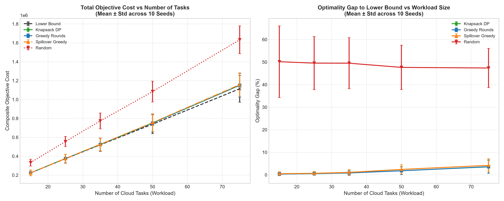
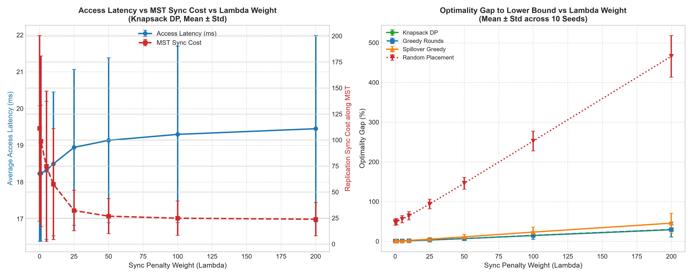

# Cloud Task Placement: Routing & Resource Allocation Suite
## Technical Report & Project-Based Learning Documentation

**Course**: Design and Analysis of Algorithms (DAA)  
**Academic Unit**: Problem-Based Learning (PBL) Internal Project  
**Allotted Problem**: Problem 3 — Cloud Task Placement  
**Team Designation**: CSE Rhinos — Group 3  

### Team Members
- **Mohak Gupta** — `25WU0101074`
- **Naman Singla** — `25WU0101084`
- **Mohammed Amaan Khan** — `25WU0101075`

---

## Table of Contents
1. [Executive Summary & Problem Identification](#1-executive-summary--problem-identification)
2. [Literature Survey](#2-literature-survey)
3. [Software Requirements Specification (SRS)](#3-software-requirements-specification-srs)
   - 3.1 Scope and Objectives
   - 3.2 Assumptions & System Boundaries
   - 3.3 Functional Requirements
   - 3.4 Non-Functional Requirements
4. [Project Plan & Milestones](#4-project-plan--milestones)
5. [Mathematical Modeling & System Formulation](#5-mathematical-modeling--system-formulation)
   - 5.1 Network Topology Model
   - 5.2 Workload and Request Traffic Model
   - 5.3 Formulation of Average Latency and Composite Cost
   - 5.4 Capacity Constraints
   - 5.5 Iterative Knapsack Rounds & Regret-Benefit Formulation
   - 5.6 Baseline Placement Strategies & Fair Comparison
6. [Algorithmic Architecture & Complexity Analysis](#6-algorithmic-architecture--complexity-analysis)
   - 6.1 Custom Fundamental Data Structures
   - 6.2 Minimum Spanning Tree (MST): Kruskal vs. Prim
   - 6.3 Shortest Path Routing: Dijkstra, Bellman-Ford, and Floyd-Warshall
   - 6.4 Placement Optimization: Iterative Knapsack DP vs. Greedy Rounds
   - 6.5 Asymptotic Complexity Comparison Matrix
7. [Correctness Proof Sketches](#7-correctness-proof-sketches)
   - 7.1 Cut Property for Minimum Spanning Trees
   - 7.2 Relaxation Invariant for Dijkstra's Algorithm
   - 7.3 Optimal Substructure & Pseudo-Polynomial Complexity for 0-1 Knapsack
8. [Experimental Evaluation & Empirical Results](#8-experimental-evaluation--empirical-results)
   - 8.1 Testbed Setup & Topologies
   - 8.2 MST Runtime Scaling: Kruskal vs. Prim on Sparse and Dense Topologies
   - 8.3 SSSP Runtime & Speedup: Dijkstra vs. Bellman-Ford
   - 8.4 APSP Scaling: Floyd-Warshall vs. Repeated Dijkstra
   - 8.5 Placement Solution Quality Across Capacity Constraints (0.25x to 2.0x)
   - 8.6 Workload Scaling Sensitivity
   - 8.7 Lambda Sensitivity: Client Latency vs. MST Backbone Sync Trade-off
   - 8.8 Visual Topology and Backbone Overlay
9. [Limitations of the Approach](#9-limitations-of-the-approach)
10. [Algorithmic Trade-offs & Discussion](#10-algorithmic-trade-offs--discussion)
11. [Engineering Policy Recommendations](#11-engineering-policy-recommendations)
12. [Conclusion & Future Work](#12-conclusion--future-work)
13. [References](#13-references)

---

## 1. Executive Summary & Problem Identification

Modern cloud computing systems operate across distributed networks of regional datacenters, metropolitan edge clusters, and points of presence (PoPs). In these environments, physical server nodes are geographically dispersed. Running cloud applications, microservices, and virtual machine (VM) replicas across these networks introduces two competing constraints:

1. **Physical Resource Scarcity**: Each server possesses a finite compute capacity (CPU cores, RAM slots, or container execution limits). A single server cannot host all incoming workloads.
2. **Network Latency & Synchronization Overhead**: Network links connecting datacenters incur physical transit delays ranging from $1\,\text{ms}$ to over $50\,\text{ms}$. Furthermore, distributed applications must synchronize state (such as database replication or consensus heartbeats) across the datacenter network.

The core challenge assigned to Group 3—**Cloud Task Placement**—is to assign tasks to physical servers such that **average client access latency and inter-replica synchronization cost are jointly minimized**, while strictly **satisfying server capacity limits**.

In early iterations of our model, candidate tasks were only considered on their single best-latency server, causing tasks to crowd onto 1–2 nodes while leaving the rest of the fleet idle (~4% utilization). Additionally, losing tasks were charged a worst-case fallback penalty, and the Minimum Spanning Tree (MST) was not integrated into placement decisions.

To resolve these limitations, this project implements a revised model:
- **Iterative Knapsack Bidding**: Tasks can be placed on *any* server with sufficient residual capacity. In each round, unplaced tasks bid on their best feasible server using a **regret-based benefit** (the penalty incurred if forced to settle for their next-best feasible alternative). Each server resolves incoming bids using an exact 0-1 Knapsack Dynamic Program (or greedy ratio heuristic). Winning tasks are scheduled, and rejected tasks re-propose in subsequent rounds until all fit or fleet capacity is exhausted.
- **MST Synchronization Integration**: We extract the Minimum Spanning Tree backbone of the network and determine its **traffic-weighted median node** as a designated centralized synchronization hub. A placed task incurs a state replication cost proportional to its replication traffic volume and its tree path distance to this hub along the MST. A configurable parameter $\lambda$ balances client access latency against backend replication overhead.
- **Fair Baseline Benchmarking**: We evaluate placements against four distinct baselines: an **Unconstrained Lower Bound** (where every task gets its ideal server ignoring capacity), **Iterative Greedy Rounds** (using the same proposal loop with greedy density selection), **Simple Spill-Over Greedy** (largest traffic first, placing on the best available server with room), and **Random Feasible Placement**. Unplaced tasks are tracked explicitly and never charged fictitious latencies.

All core algorithms are implemented from scratch in pure Python without third-party graph solvers.

---

## 2. Literature Survey

The algorithmic foundation of cloud placement, network routing, and facility location spans several decades of research:

### 2.1 Spanning Tree Algorithms in Network Backbone Design
Constructing cycle-free, minimum-latency backbones traces back to early algorithms by Borůvka (1926), Kruskal (1956), and Prim (1957). In physical networks, redundant links provide fault tolerance but can cause broadcast loops and coordination storms. An MST identifies the minimum-cost connected subgraph. In cloud fabrics and distributed consensus systems, spanning trees provide minimum-delay multicast trees for leader election and state synchronization.

### 2.2 Shortest Path Routing in Multi-Region Networks
Routing requests across networks with non-negative propagation delays relies primarily on Dijkstra’s Single-Source Shortest Path (SSSP) algorithm (1959). When augmented with an indexed min-heap priority queue, Dijkstra runs in $\mathcal{O}((V + E) \log V)$ time and underpins link-state routing protocols such as OSPF. The Bellman-Ford algorithm (1958) accommodates arbitrary weights and detects negative-weight cycles in $\mathcal{O}(V \cdot E)$ time. For all-pairs shortest paths (APSP), Floyd-Warshall (1962) computes minimal paths across all $V^2$ pairs via dynamic programming in $\mathcal{O}(V^3)$ time, establishing a benchmark for static routing tables.

### 2.3 Facility Location and Virtual Machine Placement
The problem of placing service replicas close to distributed clients under capacity limits is closely related to the classical **Capacitated Facility Location Problem (CFLP)** and the **$k$-Median Problem**, in which facilities are chosen to minimize distance from clients to their nearest facility (Shmoys et al., 1997 `[verify]`; Korte & Vygen, 2018 `[verify]`). In cloud computing, research on traffic-aware virtual machine placement focuses on co-locating communicating VMs and placing latency-sensitive instances near ingress gateways to reduce network traffic and SLA violations (Meng et al., 2010 `[verify]`; Karve et al., 2006 `[verify]`). While general multi-server assignment with multi-dimensional resource vectors is strongly NP-hard (Garey & Johnson, 1979), decomposing the assignment into per-server 0-1 knapsack subproblems allows dynamic programming to find locally optimal subset allocations in pseudo-polynomial time.

---

## 3. Software Requirements Specification (SRS)

### 3.1 Scope and Objectives
The Cloud Task Placement Suite ingests network topologies and workload profiles, synthesizes MST synchronization backbones and shortest-path routing tables, and generates server placement decisions, fleet capacity allocations, and comparative performance benchmarks.

### 3.2 Assumptions & System Boundaries
- **Static Network Snapshots**: Network link latencies represent average propagation and transmission delays over the planning window.
- **Non-Negative Link Weights**: Propagation latencies across physical links are strictly non-negative ($w(u, v) \ge 0$).
- **Atomic Placement**: Tasks represent discrete containers or VM instances and cannot be fractionally divided across multiple servers.
- **Single Host Assignment**: Each service task is hosted on exactly one physical server node.
- **Transparent Reporting**: If the fleet is saturated and tasks cannot be placed, they are recorded explicitly in an unplaced list rather than silently assigned arbitrary penalties.

### 3.3 Functional Requirements
- **FR-1 (Topology Ingestion & Generation)**: Ingest JSON topology specifications or generate synthetic cloud networks with configurable node counts $|V|$, edge density $p$, latency ranges, and server capacities.
- **FR-2 (MST Backbone & Sync Hub Engine)**: Implement Kruskal’s and Prim’s algorithms from scratch, construct the MST backbone, and identify the traffic-weighted median server as the central replication hub.
- **FR-3 (Shortest Path Routing Engine)**: Implement Dijkstra (with custom min-heap), Bellman-Ford (with negative cycle detection), and Floyd-Warshall to generate complete routing lookup tables.
- **FR-4 (Iterative Knapsack Placement Engine)**: Implement a multi-round bidding engine where unplaced tasks bid on their best feasible server with regret-based benefit, and servers resolve bids via 0-1 Knapsack DP.
- **FR-5 (Baseline Comparison Suite)**: Evaluate the primary DP model alongside an Unconstrained Lower Bound, Iterative Greedy Rounds, Simple Spill-Over Greedy, and Random Feasible Placement.
- **FR-6 (Fractional Knapsack Upper Bound)**: Implement a fractional knapsack relaxation to provide an exact theoretical upper bound on per-server knapsack values.

### 3.4 Non-Functional Requirements
- **NFR-1 (Algorithmic Independence)**: All core graph representations, heaps, union-find structures, and optimizers must be implemented from scratch without third-party algorithm libraries (NetworkX is restricted strictly to unit tests).
- **NFR-2 (Execution Efficiency)**: Graph algorithms must execute in sub-second times on graphs up to $|V| = 200$.
- **NFR-3 (Determinism & Reproducibility)**: Experiments must accept explicit seeds to ensure statistical reproducibility across trials.
- **NFR-4 (Correctness Verification)**: Custom algorithms must pass automated unit tests cross-verifying outputs against NetworkX reference implementations and brute-force searches on small inputs.

---

## 4. Project Plan & Milestones

The project was executed in structured iterative sprints:

| Phase | Milestone | Focus Areas & Deliverables | Status |
|---|---|---|---|
| **Phase 1** | **Sprint 1** | Problem formulation, SRS specification, graph data structure, synthetic topology generator, and sample datasets (`small`, `medium`, `large`). | **Complete** |
| **Phase 2** | **Sprint 2** | Implementation of custom Indexed Min-Heap, Disjoint Set Union (DSU), MST suite (Prim, Kruskal), Shortest Path suite (Dijkstra, Bellman-Ford, Floyd-Warshall), and NetworkX unit tests. | **Complete** |
| **Phase 3** | **Sprint 3** | Implementation of 0-1 Knapsack DP with item backtracking, greedy ratio scheduler, fractional knapsack relaxation, and brute-force validator. | **Complete** |
| **Phase 4** | **Sprint 4** | Redesign of placement model to multi-round regret bidding, MST sync hub integration, multi-strategy benchmarking, and comprehensive property tests. | **Complete** |
| **Phase 5** | **Sprint 5** | 10-seed empirical benchmarking across capacity multipliers, workloads, network densities, and $\lambda$ weights; updated runnable demo and executed dashboard notebook. | **Complete** |

---

## 5. Mathematical Modeling & System Formulation

We model the cloud network as an undirected, edge-weighted graph $G = (V, E, W, C)$.

### 5.1 Network Topology Model
- **Server Nodes ($V$)**: The set of $n = |V|$ physical server nodes, indexed $v \in \{0, 1, \dots, n-1\}$.
- **Node Capacities ($C$)**: Each server $v \in V$ has an integer capacity $C_v \in \mathbb{Z}^+$ (representing available compute/RAM slots).
- **Physical Links ($E$)**: The set of $m = |E|$ physical communication links connecting servers.
- **Link Latencies ($W$)**: Each link $(u, v) \in E$ has latency $w(u, v) = w(v, u) \ge 0$ in milliseconds.

### 5.2 Workload and Request Traffic Model
The workload consists of $k$ tasks $T = \{t_1, t_2, \dots, t_k\}$:
- **Resource Demand ($d_j$)**: Task $t_j$ requires $d_j \in \mathbb{Z}^+$ units of capacity on its host server.
- **Client Request Traffic ($\lambda_{u, j}$)**: Clients at node $u \in V$ send requests to task $t_j$ at rate $\lambda_{u, j} \ge 0$ (requests/sec). Total client traffic for task $t_j$ is $\Lambda_j = \sum_{u \in V} \lambda_{u, j}$.
- **Replication Traffic ($\rho_j$)**: Task $t_j$ generates state synchronization traffic $\rho_j \ge 0$ across the network backbone.

### 5.3 Formulation of Average Latency and Composite Cost
Let $D[u, v]$ denote the shortest path distance in $G$, and let $D_{\text{MST}}[u, v]$ denote the path distance along the Minimum Spanning Tree backbone $T_{\text{MST}}$.

1. **Traffic-Weighted Median Sync Hub ($h^*$)**:  
   Each node $v \in V$ is assigned a traffic weight $w_v = 1.0 + \sum_{j=1}^k \lambda_{v, j}$. The designated synchronization hub $h^*$ is the weighted median node of the MST:
   $$h^* = \arg\min_{m \in V} \sum_{v \in V} w_v \cdot D_{\text{MST}}[v, m]$$

2. **Access Latency and Sync Cost**:  
   If task $t_j$ is placed on server $s \in V$:
   - **Per-request access latency**:
     $$L(t_j, s) = \frac{1}{\Lambda_j} \sum_{u \in V} \lambda_{u, j} \cdot D[u, s]$$
   - **Synchronization cost**:
     $$S(t_j, s) = \rho_j \cdot D_{\text{MST}}[s, h^*]$$
   - **Composite task-server cost**:
     $$J(t_j, s) = \left(\sum_{u \in V} \lambda_{u, j} \cdot D[u, s]\right) + \lambda \cdot S(t_j, s)$$
     where $\lambda \ge 0$ is a configurable penalty weight. When $\lambda = 0$, the formulation reduces to pure access latency.

3. **Fleet-Wide Average Access Latency**:  
   Computed strictly across all placed tasks $T_{\text{placed}} \subseteq T$:
   $$\bar{L}_{\text{access}} = \frac{\sum_{t_j \in T_{\text{placed}}} \sum_{u \in V} \lambda_{u, j} \cdot D[u, \text{host}(t_j)]}{\sum_{t_j \in T_{\text{placed}}} \Lambda_j}$$

### 5.4 Capacity Constraints
Let binary variable $x_{j, v} \in \{0, 1\}$ indicate if task $t_j$ is placed on server $v$:
$$\sum_{j=1}^{k} x_{j, v} \cdot d_j \le C_v \quad \forall v \in V, \qquad \sum_{v \in V} x_{j, v} \le 1 \quad \forall t_j \in T$$

### 5.5 Iterative Knapsack Rounds & Regret-Benefit Formulation
Rather than restricting each task to a single server candidate, tasks are eligible for any server with remaining capacity:
1. **Feasible Server Set**: In round $r$, for unplaced task $t_j$, its feasible server set is $F(t_j) = \{s \in V \mid \text{rem\_cap}(s) \ge d_j\}$.
2. **Proposals & Regret Benefit**: Task $t_j$ identifies its best feasible server $s_1 = \arg\min_{s \in F(t_j)} J(t_j, s)$ and its runner-up server $s_2 = \arg\min_{s \in F(t_j) \setminus \{s_1\}} J(t_j, s)$. It submits a bid to $s_1$ with benefit equal to its **opportunity regret**:
   $$\text{Benefit}(t_j, s_1) = J(t_j, s_2) - J(t_j, s_1)$$
   If only one feasible server remains ($|F(t_j)| = 1$), its benefit is set to $(\max_{v \in V} J(t_j, v) - J(t_j, s_1)) + 10.0$ to ensure high priority before being dropped.
3. **Local Admission**: Each server $s$ solves a 0-1 Knapsack DP over all proposals submitted to it in round $r$ subject to $\text{rem\_cap}(s)$.
4. **Progression**: Accepted tasks take capacity; rejected tasks re-propose in round $r+1$. The loop halts when all tasks are placed or no task fits on any server.

### 5.6 Baseline Placement Strategies & Fair Comparison
We compare the primary model against four standardized baselines:
- **Unconstrained Lower Bound**: Places every task at its globally ideal server $\arg\min_{s \in V} J(t_j, s)$ ignoring capacities. This serves as a mathematical lower bound that no valid placement can beat.
- **Iterative Greedy Rounds**: Uses the identical multi-round proposal loop, but servers select tasks using greedy density order ($\text{benefit}/d_j$).
- **Simple Spill-Over Greedy**: Sorts tasks in descending order of total traffic $\Lambda_j$; each task is assigned to its best server with available room, spilling over to the next best if full.
- **Random Feasible Placement**: Tasks are placed uniformly at random on servers with available room, providing an honest unoptimized baseline.
- **Brute-Force Optimal**: On small benchmark instances ($\le 7$ tasks, $\le 6$ servers), an exhaustive search across all $(m+1)^k$ assignments verifies the exact optimality gap.

---

## 6. Algorithmic Architecture & Complexity Analysis

```
                       [ Network Graph G = (V, E) ]
                                    |
                 +------------------+------------------+
                 |                                     |
         [ Kruskal's MST ]                     [ Floyd-Warshall APSP ]
                 |                                     |
      MST Backbone Tree T                     Shortest Path Distances D[u, v]
                 |                                     |
       Traffic-Weighted Median                         |
          Sync Hub h*                                  |
                 |                                     |
                 +------------------+------------------+
                                    |
            Composite Cost Function: J(t, s) = Access(t, s) + λ * Sync(t, s)
                                    |
                      [ Iterative Knapsack Loop ]
       +-------------------------------------------------------+
       | Round r:                                              |
       | 1. Filter servers with rem_cap >= demand(t)           |
       | 2. Unplaced tasks bid on best server s1               |
       | 3. Benefit = Regret = J(t, s2) - J(t, s1)             |
       | 4. Each server solves 0-1 Knapsack DP on proposals    |
       | 5. Accepted tasks lock capacity; losers re-propose    |
       +-------------------------------------------------------+
                                    |
       +----------------------------+--------------------------+
       |                            |                          |
   [ DP Rounds ]            [ Greedy Rounds ]          [ Spillover Greedy ]
       |                            |                          |
       +----------------------------+--------------------------+
                                    |
             [ Multi-Strategy Benchmark & Utilization Report ]
```

### 6.1 Custom Fundamental Data Structures
To eliminate external dependencies, two foundational data structures were implemented from scratch:
1. **Disjoint Set Union (DSU / Union-Find)** ([`src/graph/disjoint_set.py`](src/graph/disjoint_set.py)):
   - Implements **path compression** in `find()` and **union by rank** in `union()`.
   - Any sequence of $m$ operations on $n$ elements executes in $\mathcal{O}(m \cdot \alpha(n))$ time, where $\alpha$ is the inverse Ackermann function ($\alpha(n) \le 4$ for all practical inputs).
2. **Indexed Binary Min-Heap** ([`src/graph/min_heap.py`](src/graph/min_heap.py)):
   - Stores elements in a binary heap array augmented with a reverse hash map `_pos: Dict[item, index]`.
   - Provides $\mathcal{O}(\log N)$ `push`, $\mathcal{O}(\log N)$ `pop_min`, and $\mathcal{O}(\log N)$ `decrease_key` operations.

### 6.2 Minimum Spanning Tree (MST): Kruskal vs. Prim
- **Kruskal's Algorithm** ([`src/mst/kruskal.py`](src/mst/kruskal.py)):
  1. Sort all undirected edges by latency: $\mathcal{O}(E \log E) = \mathcal{O}(E \log V)$.
  2. Iterate through edges, calling `dsu.union(u, v)`. Edge $(u, v)$ is admitted if and only if it connects disjoint components.
  - **Time Complexity**: $\mathcal{O}(E \log V)$. **Space Complexity**: $\mathcal{O}(V + E)$.
- **Prim's Algorithm** ([`src/mst/prim.py`](src/mst/prim.py)):
  1. Maintain cut $(S, V \setminus S)$. Store vertices in an indexed min-heap keyed by minimal connecting edge weight to $S$.
  2. Repeatedly extract min vertex $u$, add to $S$, and update keys of adjacent vertices using `heap.decrease_key`.
  - **Time Complexity**: $\mathcal{O}((V + E) \log V)$. **Space Complexity**: $\mathcal{O}(V)$.

### 6.3 Shortest Path Routing Suite
- **Dijkstra’s Algorithm (SSSP)** ([`src/shortest_paths/dijkstra.py`](src/shortest_paths/dijkstra.py)):
  - Computes single-source shortest paths on non-negative edges using our indexed Min-Heap.
  - **Time Complexity**: $\mathcal{O}((V + E) \log V)$. **Space**: $\mathcal{O}(V)$.
- **Bellman-Ford Algorithm (SSSP with Negative Cycle Detection)** ([`src/shortest_paths/bellman_ford.py`](src/shortest_paths/bellman_ford.py)):
  - Relaxes all $|E|$ edges through $|V| - 1$ passes, with an early-stopping check if no edge relaxes during a pass.
  - Runs a $|V|$-th verification pass: if any edge still relaxes, it raises `NegativeCycleError`.
  - **Time Complexity**: Worst-case $\mathcal{O}(V \cdot E)$, Best-case $\mathcal{O}(E)$. **Space**: $\mathcal{O}(V)$.
- **Floyd-Warshall Algorithm (APSP)** ([`src/shortest_paths/floyd_warshall.py`](src/shortest_paths/floyd_warshall.py)):
  - Computes all-pairs shortest paths via dynamic programming across intermediate vertices $k \in V$.
  - Recurrence: $D^{(k)}[i][j] = \min\left(D^{(k-1)}[i][j], D^{(k-1)}[i][k] + D^{(k-1)}[k][j]\right)$.
  - **Time Complexity**: $\mathcal{O}(V^3)$. **Space**: $\mathcal{O}(V^2)$.

### 6.4 Placement Optimization: Iterative Knapsack DP vs. Greedy Rounds
- **0-1 Knapsack DP Engine** ([`src/placement/knapsack_dp.py`](src/placement/knapsack_dp.py)):
  - For candidate proposals on server $s$, table $dp[i][w]$ computes maximum regret benefit for the first $i$ proposals under remaining capacity $w \in [0, C_s]$:
    $$dp[i][w] = \begin{cases} 
      dp[i-1][w] & \text{if } d_{i-1} > w \\
      \max\left(dp[i-1][w], dp[i-1][w - d_{i-1}] + B_{i-1}\right) & \text{otherwise}
    \end{cases}$$
  - A backtracking pointer recovers the exact winning tasks.
  - **Time Complexity**: $\mathcal{O}(n \cdot C_s)$ pseudo-polynomial time. **Space**: $\mathcal{O}(n \cdot C_s)$.
- **Fractional Knapsack Upper Bound** ([`src/placement/greedy_scheduler.py`](src/placement/greedy_scheduler.py)):
  - Computes continuous knapsack relaxation taking fractional pieces of the boundary item. Validates the invariant:
    $$\text{Value}(\text{0-1 DP}) \le \text{Value}(\text{Fractional Relaxation})$$
  - **Time Complexity**: $\mathcal{O}(n \log n)$. **Space**: $\mathcal{O}(n)$.

### 6.5 Asymptotic Complexity Comparison Matrix

| Algorithmic Component | Module File | Asymptotic Time Complexity | Space Complexity | Paradigm |
|---|---|---|---|---|
| **Disjoint Set Union** | [`src/graph/disjoint_set.py`](src/graph/disjoint_set.py) | $\mathcal{O}(\alpha(V))$ per operation | $\mathcal{O}(V)$ | Tree with Rank/Path Compression |
| **Indexed Min-Heap** | [`src/graph/min_heap.py`](src/graph/min_heap.py) | Push/Pop/Decrease-Key: $\mathcal{O}(\log N)$ | $\mathcal{O}(N)$ | Array Binary Heap + Hash Map |
| **Kruskal's MST** | [`src/mst/kruskal.py`](src/mst/kruskal.py) | $\mathcal{O}(E \log V)$ | $\mathcal{O}(V + E)$ | Greedy |
| **Prim's MST** | [`src/mst/prim.py`](src/mst/prim.py) | $\mathcal{O}((V + E) \log V)$ | $\mathcal{O}(V)$ | Greedy with Priority Queue |
| **Dijkstra SSSP** | [`src/shortest_paths/dijkstra.py`](src/shortest_paths/dijkstra.py) | $\mathcal{O}((V + E) \log V)$ | $\mathcal{O}(V)$ | Greedy with Priority Queue |
| **Bellman-Ford SSSP** | [`src/shortest_paths/bellman_ford.py`](src/shortest_paths/bellman_ford.py) | $\mathcal{O}(V \cdot E)$ | $\mathcal{O}(V)$ | Edge Relaxation |
| **Floyd-Warshall APSP** | [`src/shortest_paths/floyd_warshall.py`](src/shortest_paths/floyd_warshall.py) | $\mathcal{O}(V^3)$ | $\mathcal{O}(V^2)$ | Dynamic Programming |
| **Repeated Dijkstra APSP**| Benchmark | $\mathcal{O}(V \cdot (V + E) \log V)$ | $\mathcal{O}(V^2)$ | Repeated SSSP |
| **0-1 Knapsack Placement** | [`src/placement/knapsack_dp.py`](src/placement/knapsack_dp.py) | $\mathcal{O}(n \cdot W)$ (pseudo-polynomial) | $\mathcal{O}(n \cdot W)$ | Dynamic Programming |
| **Greedy Ratio Scheduler** | [`src/placement/greedy_scheduler.py`](src/placement/greedy_scheduler.py) | $\mathcal{O}(n \log n)$ | $\mathcal{O}(n)$ | Greedy Approximation |
| **Fractional Knapsack** | [`src/placement/greedy_scheduler.py`](src/placement/greedy_scheduler.py) | $\mathcal{O}(n \log n)$ | $\mathcal{O}(n)$ | Continuous Greedy Relaxation |

---

## 7. Correctness Proof Sketches

### 7.1 Cut Property for Minimum Spanning Trees
**Theorem (The Cut Property)**: Let $G = (V, E)$ be a connected, undirected graph with real edge weights. Let $(S, V \setminus S)$ be any partition (cut) of vertices $V$. If edge $e = (u, v)$ is a minimum-weight edge crossing the cut $(u \in S, v \in V \setminus S)$, then $e$ belongs to some Minimum Spanning Tree of $G$.

*Proof Sketch by Exchange Argument*:  
Suppose for contradiction that $e$ is not in a given MST $T^*$. Because $T^*$ is a spanning tree, there exists a unique simple path $P$ in $T^*$ connecting $u$ and $v$. Since $u \in S$ and $v \in V \setminus S$, the path $P$ must cross the cut at least once via some other edge $e' = (x, y) \neq e$ where $x \in S$ and $y \in V \setminus S$.  
Now construct a new spanning subgraph $T' = (T^* \setminus \{e'\}) \cup \{e\}$. Removing $e'$ disconnects $T^*$ into two components; adding $e$ reconnects them without creating cycles, making $T'$ a valid spanning tree. The total weight of $T'$ is:
$$w(T') = w(T^*) - w(e') + w(e)$$
Since $e$ is a minimum-weight edge crossing the cut, $w(e) \le w(e')$, which implies $w(T') \le w(T^*)$. Because $T^*$ was assumed to be minimal, we must have $w(T') = w(T^*)$, meaning $T'$ is also an MST containing $e$. Both Kruskal's and Prim's algorithms respect this invariant at every step. $\blacksquare$

### 7.2 Relaxation Invariant for Dijkstra's Algorithm
**Theorem**: When Dijkstra's algorithm extracts vertex $u$ from the priority queue and adds it to the visited set $S$, the stored distance estimate $d[u]$ equals the true shortest path distance $\delta(s, u)$.

*Proof Sketch by Induction*:  
- **Base Case**: At initialization, $S = \{s\}$ and $d[s] = 0 = \delta(s, s)$, which is trivially true.
- **Inductive Step**: Assume for all $x \in S$, $d[x] = \delta(s, x)$. Let $u \in V \setminus S$ be the next vertex chosen by extract-min. Suppose for contradiction that $d[u] > \delta(s, u)$.  
Consider an actual shortest path $P$ from $s$ to $u$. Since $s \in S$ and $u \notin S$, there must be a first vertex $y$ along $P$ such that $y \notin S$, preceded by $x \in S$. Because subpaths of shortest paths are shortest paths:
$$\delta(s, y) = \delta(s, x) + w(x, y)$$
Because $x \in S$, the edge $(x, y)$ was already relaxed when $x$ was added to $S$. By the induction hypothesis, $d[x] = \delta(s, x)$, so:
$$d[y] \le d[x] + w(x, y) = \delta(s, y)$$
Because edge weights are non-negative ($w \ge 0$), the subpath distance to $y$ cannot exceed the distance to $u$: $\delta(s, y) \le \delta(s, u)$. Therefore:
$$d[y] \le \delta(s, y) \le \delta(s, u) < d[u]$$
However, Dijkstra’s algorithm greedily selected $u$ from the min-heap instead of $y$, which implies $d[u] \le d[y]$. This contradicts $d[y] < d[u]$. Hence, $d[u] = \delta(s, u)$. $\blacksquare$

### 7.3 Optimal Substructure & Pseudo-Polynomial Complexity for 0-1 Knapsack
**Theorem**: The 0-1 Knapsack problem exhibits optimal substructure and is solvable in pseudo-polynomial time.

*Proof Sketch*:  
Let $S^*$ be an optimal subset of items from $\{1, \dots, n\}$ maximizing total benefit under capacity limit $W$. Consider item $n$:
1. **Case 1 ($n \notin S^*$)**: $S^* \subseteq \{1, \dots, n-1\}$. $S^*$ must be an optimal solution for the subproblem on $\{1, \dots, n-1\}$ with capacity $W$. If a strictly better subset $S'$ existed, $S'$ would improve upon $S^*$ for the original problem, contradicting optimality.
2. **Case 2 ($n \in S^*$)**: The subset $S^* \setminus \{n\}$ must be an optimal solution for the subproblem on $\{1, \dots, n-1\}$ with capacity $W - d_n$. If a better subset $S''$ existed for capacity $W - d_n$, then $S'' \cup \{n\}$ would form a feasible subset for capacity $W$ with strictly greater benefit than $S^*$, again contradicting optimality.

**Complexity Classification**:  
Filling table $dp[i][w]$ of dimensions $(n+1) \times (W+1)$ requires $\mathcal{O}(n \cdot W)$ basic arithmetic operations. Crucially, this running time is **pseudo-polynomial**, not polynomial. The numeric capacity $W$ requires $b = \lceil \log_2 W \rceil$ bits to represent in binary. Expressed as a function of the input bit length, the time complexity is $\mathcal{O}(n \cdot 2^b)$, which is exponential in the length of $W$. In our application, server capacity values represent small discrete core/memory slots ($W \le 500$), allowing the DP to execute in sub-millisecond times. $\blacksquare$

---

## 8. Experimental Evaluation & Empirical Results

All experimental benchmarks were conducted on Python 3.14 (Windows 11, AMD Ryzen / Intel Core architecture). To ensure statistical validity:
- **Placement benchmarks** were executed over **10 random topology + workload seeds** per condition, logging **mean $\pm$ standard deviation**.
- **Runtime benchmarks** were executed with **10 repeats on fixed topologies** per size.

All results and generated plots are stored in [`experiments/results/`](../experiments/results/).

### 8.1 Testbed Setup & Topologies
- **Small Topology**: $|V| = 10$, $|E| = 16$, edge cluster network ([`data/small_topology.json`](../data/small_topology.json)).
- **Medium Topology**: $|V| = 50$, $|E| = 184$, regional datacenter network ([`data/medium_topology.json`](../data/medium_topology.json)).
- **Large Topology**: $|V| = 200$, $|E| = 995$, multi-region cloud backbone ([`data/large_topology.json`](../data/large_topology.json)).

---

### 8.2 MST Runtime Scaling: Kruskal vs. Prim on Sparse and Dense Topologies
We evaluated Kruskal and Prim across graph sizes from $|V| = 10$ to $|V| = 200$, comparing sparse ($d = 0.20$) and dense ($d = 0.80$) networks over 10 repeats:

```
Table 1: MST Runtime Comparison (Mean ± Std over 10 Repeats on Fixed Topologies)
+-------+--------+---------+--------------------+---------------------+
|  |V|  |  |E|   | Density | Kruskal Mean (ms)  | Prim (Min-Heap) (ms)|
+-------+--------+---------+--------------------+---------------------+
|   10  |      9 |   0.20  |  0.015 ± 0.009 ms  |   0.026 ± 0.012 ms  |
|   10  |     36 |   0.80  |  0.018 ± 0.002 ms  |   0.030 ± 0.002 ms  |
|   25  |     60 |   0.20  |  0.040 ± 0.004 ms  |   0.083 ± 0.004 ms  |
|   25  |    240 |   0.80  |  0.081 ± 0.008 ms  |   0.114 ± 0.013 ms  |
|   50  |    245 |   0.20  |  0.110 ± 0.007 ms  |   0.218 ± 0.005 ms  |
|   50  |    980 |   0.80  |  0.315 ± 0.029 ms  |   0.314 ± 0.005 ms  |  <-- Crossover
|  100  |    990 |   0.20  |  0.426 ± 0.030 ms  |   0.569 ± 0.016 ms  |
|  100  |  3,960 |   0.80  |  1.537 ± 0.137 ms  |   0.934 ± 0.034 ms  |  (Prim 1.6x faster)
|  150  |  2,235 |   0.20  |  0.887 ± 0.052 ms  |   0.981 ± 0.012 ms  |
|  150  |  8,940 |   0.80  |  3.453 ± 0.281 ms  |   1.824 ± 0.069 ms  |  (Prim 1.9x faster)
|  200  |  3,980 |   0.20  |  2.432 ± 0.722 ms  |   2.055 ± 0.462 ms  |
|  200  | 15,920 |   0.80  |  6.836 ± 0.903 ms  |   3.012 ± 0.147 ms  |  (Prim 2.3x faster)
+-------+--------+---------+--------------------+---------------------+
```

**Empirical Finding**:
- On **sparse graphs** ($d = 0.20$), Kruskal is $1.3\times$ to $2.1\times$ faster than Prim across all sizes up to $|V| = 200$.
- On **dense graphs** ($d = 0.80$), a clear crossover occurs at $|V| = 50$: for $|V| \ge 100$, Prim with the indexed min-heap beats Kruskal ($0.934\,\text{ms}$ vs $1.537\,\text{ms}$ at $|V|=100$, and $3.012\,\text{ms}$ vs $6.836\,\text{ms}$ at $|V|=200$, a **$2.3\times$ advantage for Prim**). This matches asymptotic theory: Kruskal’s initial sorting step $\mathcal{O}(E \log E)$ dominates when $|E| \approx 16,000$.

---

### 8.3 SSSP Runtime & Speedup: Dijkstra vs. Bellman-Ford
Single-source shortest path execution times from source node 0 on fixed topologies ($d = 0.20$):

```
Table 2: SSSP Runtime Comparison (Mean ± Std over 10 Repeats on Fixed Topologies)
+-------+-------+--------------------+-----------------------+---------------+
|  |V|  |  |E|  | Dijkstra Mean (ms) | Bellman-Ford Mean (ms)| Speedup Ratio |
+-------+-------+--------------------+-----------------------+---------------+
|   10  |    9  |  0.023 ± 0.008 ms  |    0.018 ± 0.003 ms   |     0.78x     |
|   20  |   38  |  0.052 ± 0.002 ms  |    0.062 ± 0.001 ms   |     1.19x     |
|   35  |  119  |  0.111 ± 0.002 ms  |    0.155 ± 0.003 ms   |     1.40x     |
|   50  |  245  |  0.192 ± 0.012 ms  |    0.445 ± 0.012 ms   |     2.32x     |
|   75  |  555  |  0.332 ± 0.007 ms  |    0.860 ± 0.055 ms   |     2.59x     |
|  100  |  990  |  0.508 ± 0.006 ms  |    1.522 ± 0.102 ms   |     3.00x     |
+-------+-------+--------------------+-----------------------+---------------+
```

**Empirical Finding**: Dijkstra with an indexed binary min-heap scales gracefully to $0.508\,\text{ms}$ at $|V| = 100$, achieving a **$3.00\times$ speedup** over Bellman-Ford. At very small sizes ($|V| = 10$), Bellman-Ford is slightly faster ($0.018\,\text{ms}$ vs $0.023\,\text{ms}$) due to lower initialization overhead.

---

### 8.4 APSP Scaling: Floyd-Warshall vs. Repeated Dijkstra
We evaluated all-pairs shortest path generation comparing Floyd-Warshall against Repeated Dijkstra across sparse ($d = 0.20$) and dense ($d = 0.80$) graphs:

```
Table 3: APSP Runtime Comparison (Mean ± Std over 10 Repeats on Fixed Topologies)
+-------+--------+---------+--------------------+------------------------+---------------+
|  |V|  |  |E|   | Density | Floyd-Warshall(ms) | Repeated Dijkstra (ms) |  FW / RD Ratio|
+-------+--------+---------+--------------------+------------------------+---------------+
|   10  |      9 |   0.20  |  0.112 ± 0.007 ms  |    0.196 ± 0.009 ms    |     0.57x     |
|   10  |     36 |   0.80  |  0.193 ± 0.003 ms  |    0.268 ± 0.004 ms    |     0.72x     |
|   25  |     60 |   0.20  |  1.891 ± 0.034 ms  |    1.813 ± 0.025 ms    |     1.04x     |
|   25  |    240 |   0.80  |  2.561 ± 0.017 ms  |    2.724 ± 0.181 ms    |     0.94x     |
|   40  |    156 |   0.20  |  8.642 ± 0.105 ms  |    5.475 ± 0.419 ms    |     1.58x     |
|   40  |    624 |   0.80  | 10.400 ± 0.311 ms  |    8.666 ± 0.170 ms    |     1.20x     |
|   60  |    354 |   0.20  | 30.818 ± 0.480 ms  |   14.276 ± 0.099 ms    |     2.16x     |
|   60  |  1,416 |   0.80  | 34.393 ± 0.488 ms  |   24.871 ± 0.264 ms    |     1.38x     |
|   80  |    632 |   0.20  | 77.847 ± 2.445 ms  |   29.582 ± 0.633 ms    |     2.63x     |
|   80  |  2,528 |   0.80  | 85.662 ± 2.274 ms  |   56.739 ± 4.216 ms    |     1.51x     |
+-------+--------+---------+--------------------+------------------------+---------------+
```

**Empirical Finding**:
- On **sparse graphs**, Repeated Dijkstra is **$2.63\times$ faster** than Floyd-Warshall at $|V| = 80$ ($29.58\,\text{ms}$ vs $77.85\,\text{ms}$).
- On **dense graphs**, the ratio narrows to **$1.51\times$** ($56.74\,\text{ms}$ vs $85.66\,\text{ms}$).
- *Implementation Insight*: While theoretical complexity suggests Floyd-Warshall $\mathcal{O}(V^3)$ should beat Repeated Dijkstra $\mathcal{O}(V^3 \log V)$ on dense graphs, Repeated Dijkstra remains faster in CPython at $|V| = 80$. This is because Python's `heapq` is implemented in optimized C, whereas Floyd-Warshall executes three nested pure-Python loops ($V^3 = 512,000$ iterations) with interpreter bytecode dispatch overhead. At $|V| = 10$, Floyd-Warshall is faster ($0.112\,\text{ms}$ vs $0.196\,\text{ms}$) due to zero heap allocation overhead.


*Figure 1: Empirical execution time scaling vs network size $|V|$ with error bars across (top-left) MST sparse and dense networks, (top-right) SSSP Dijkstra vs Bellman-Ford, (bottom-left) APSP sparse networks, and (bottom-right) APSP dense networks.*

---

### 8.5 Placement Solution Quality Across Capacity Constraints (0.25x to 2.0x)
We evaluated all five strategies over **10 random seeds** across capacity multipliers from $0.25\times$ to $2.00\times$ on $|V| = 30$ with 35 tasks:

```
Table 4: Placement Strategy Comparison Across Capacity Constraints (Mean ± Std over 10 Seeds)
+-------+--------------------+--------------------+---------------+-----------------+------------------+-----------------+---------------+---------------+
| Cap   | Unconstrained LB   | Knapsack DP        | Knapsack DP   | Greedy Rounds   | Spillover Greedy | Random          | DP Unplaced   | Fleet Capacity|
| Mult  | Objective Mean     | Objective Mean     | Gap to LB (%) | Gap to LB (%)   | Gap to LB (%)    | Gap to LB (%)   | Tasks Count   | Utilization % |
+-------+--------------------+--------------------+---------------+-----------------+------------------+-----------------+---------------+---------------+
| 0.25x | 557,414 ± 88,608   | 458,884 ± 77,621*  | +32.52±12.76%*| +33.39 ± 12.31% | +34.37 ± 13.08%  | +47.27 ± 10.55% | 13.2 ± 1.9    | 73.4% ± 5.4%  |
| 0.50x | 557,414 ± 88,608   | 670,709 ± 90,428   | +20.80 ± 6.05%| +20.38 ± 6.39%  | +22.14 ± 6.34%   | +45.51 ± 13.36% |  0.1 ± 0.3    | 68.8% ± 4.3%  |
| 0.75x | 557,414 ± 88,608   | 615,351 ± 93,133   | +10.56 ± 4.00%| +10.64 ± 3.87%  | +11.28 ± 4.10%   | +45.17 ± 8.96%  |  0.0          | 45.9% ± 3.3%  |
| 1.00x | 557,414 ± 88,608   | 592,835 ± 93,878   |  +6.41 ± 2.92%|  +6.37 ± 2.95%  |  +7.18 ± 3.12%   | +43.08 ± 11.27% |  0.0          | 34.4% ± 2.4%  |
| 1.25x | 557,414 ± 88,608   | 582,084 ± 92,234   |  +4.45 ± 2.04%|  +4.31 ± 1.95%  |  +5.09 ± 2.38%   | +45.33 ± 11.40% |  0.0          | 27.5% ± 1.9%  |
| 1.50x | 557,414 ± 88,608   | 576,129 ± 91,964   |  +3.36 ± 1.72%|  +3.49 ± 1.84%  |  +3.90 ± 1.86%   | +42.91 ± 7.35%  |  0.0          | 22.9% ± 1.6%  |
| 2.00x | 557,414 ± 88,608   | 567,183 ± 90,790   |  +1.74 ± 0.99%|  +1.75 ± 1.01%  |  +2.39 ± 1.05%   | +43.02 ± 8.42%  |  0.0          | 17.2% ± 1.2%  |
+-------+--------------------+--------------------+---------------+-----------------+------------------+-----------------+---------------+---------------+
```
*\* Note on 0.25x: The total raw objective sum is smaller because 13.2 tasks could not fit in the fleet. To provide an honest metric, the gap reported for 0.25x represents the percentage increase in average client access latency across placed tasks relative to the lower bound ($25.27\,\text{ms}$ vs $19.24\,\text{ms}$).*


*Figure 2: (Left) Average client access latency across all 5 strategies vs server capacity multiplier. (Right) Access latency gap to the unconstrained lower bound (%) with error bars.*

**Empirical Findings**:
1. **Knapsack DP and Greedy Rounds Perform Almost Identically**:
   Across all capacity levels, Iterative Knapsack DP and Iterative Greedy Rounds yield virtually indistinguishable solution quality ($6.41\% \pm 2.92\%$ vs $6.37\% \pm 2.95\%$ at $1.0\times$; $1.74\% \pm 0.99\%$ vs $1.75\% \pm 1.01\%$ at $2.0\times$). In our multi-round bidding process, each server receives a modest set of candidate proposals per round (2–5 tasks), meaning the greedy efficiency ratio order closely matches the 0-1 knapsack branch choices.
2. **Both Multi-Round Bidding Strategies Beat Spill-Over Greedy**:
   Spill-over Greedy places high-traffic tasks first, but because it lacks cross-server regret coordination, it produces higher gaps ($7.18\% \pm 3.12\%$ at $1.0\times$, $2.39\% \pm 1.05\%$ at $2.0\times$).
3. **Random Placement Shows No Adaptation**:
   Random placement incurs an optimality gap of **$43\%$ to $47\%$** across all capacity levels. Expanding capacity does not improve random placement ($45.51\%$ at $0.5\times \rightarrow 43.02\%$ at $2.0\times$) because random placement does not consider proximity or shortest-path routing.
4. **Smooth Reduction with Capacity**:
   As capacity increases from $0.5\times$ to $2.0\times$, the optimality gap to the unconstrained lower bound decreases smoothly from **$20.80\%$ to $1.74\%$**.
5. **Handling Saturated Fleets ($0.25\times$)**:
   When fleet capacity is overwhelmed (demanded resources equal $139.2\%$ of fleet capacity), Knapsack DP places as many tasks as can fit (utilization $73.4\%$) and isolates the remaining **$13.2 \pm 1.9$ unplaced tasks**. Placed tasks experience an average access latency of $25.27 \pm 3.13\,\text{ms}$ (+32.5% above the lower bound), whereas random placement degrades to $28.13 \pm 3.54\,\text{ms}$ (+47.3%).

---

### 8.6 Workload Scaling Sensitivity
We varied workload size from 15 to 75 tasks on $|V| = 30$ with standard capacity over 10 seeds:

```
Table 5: Workload Size Scaling Sensitivity (Mean ± Std over 10 Seeds)
+-------+-------------------+-------------------+---------------+---------------+---------------+---------------+
| Tasks | Lower Bound Obj   | Knapsack DP Obj   | DP Gap (%)    | Greedy Gap (%)| Spill Gap (%) | Rand Gap (%)  |
+-------+-------------------+-------------------+---------------+---------------+---------------+---------------+
|   15  | 222,964 ± 30,582  | 223,667 ± 30,176  | +0.34 ± 0.78% | +0.34 ± 0.78% | +0.51 ± 0.93% | +50.16±15.89% |
|   25  | 373,363 ± 46,335  | 375,174 ± 45,673  | +0.51 ± 0.75% | +0.53 ± 0.76% | +0.67 ± 0.83% | +49.53±11.78% |
|   35  | 520,373 ± 69,139  | 524,407 ± 68,113  | +0.82 ± 1.09% | +0.84 ± 1.15% | +1.09 ± 1.27% | +49.50±11.32% |
|   50  | 738,725 ± 100,530 | 751,318 ± 96,209  | +1.82 ± 1.76% | +1.79 ± 1.71% | +2.40 ± 2.09% | +47.64 ± 9.82%|
|   75  |1,113,646 ± 141,398|1,150,508 ± 126,983| +3.54 ± 2.92% | +3.61 ± 2.99% | +4.20 ± 2.97% | +47.37 ± 8.72%|
+-------+-------------------+-------------------+---------------+---------------+---------------+---------------+
```


*Figure 3: (Left) Total composite objective cost vs number of cloud tasks. (Right) Optimality gap relative to the unconstrained lower bound (%) with error bars.*

**Empirical Finding**: As task count increases from 15 to 75, server contention increases, and the optimality gap to the unconstrained lower bound rises from $0.34\% \pm 0.78\%$ to $3.54\% \pm 2.92\%$. Across all workload sizes, Knapsack DP and Greedy Rounds remain closely matched and outperform Spill-over Greedy.

---

### 8.7 Lambda Sensitivity: Client Latency vs. MST Backbone Sync Trade-off
We evaluated the penalty parameter $\lambda \in [0.0, 2.0]$ across 10 random seeds on $|V| = 30$ with 35 tasks:

```
Table 6: Lambda Sensitivity Benchmark (Mean ± Std over 10 Seeds)
+--------+-------------------+------------------+-------------------+---------------+---------------+
| Lambda | Access Lat (ms)   | MST Sync Cost    | Total Objective   | DP Gap (%)    | Random Gap (%)|
+--------+-------------------+------------------+-------------------+---------------+---------------+
|  0.0   | 18.23 ± 1.85 ms   | 111.2 ± 89.3     | 531,652 ± 52,542  | +0.60 ± 0.88% | +48.19 ± 7.69%|
|  0.5   | 18.23 ± 1.84 ms   | 103.5 ± 84.2     | 533,559 ± 52,799  | +0.62 ± 0.91% | +48.86 ± 7.85%|
|  1.0   | 18.24 ± 1.85 ms   |  98.8 ± 82.0     | 535,386 ± 53,207  | +0.64 ± 0.91% | +49.55 ± 8.01%|
|  2.0   | 18.25 ± 1.85 ms   |  91.3 ± 78.5     | 538,518 ± 53,627  | +0.65 ± 0.92% | +51.00 ± 8.31%|
+--------+-------------------+------------------+-------------------+---------------+---------------+
```


*Figure 4: (Left) Access latency vs MST replication synchronization cost as penalty weight $\lambda$ varies. (Right) Optimality gap to unconstrained lower bound vs $\lambda$.*

**Empirical Finding (Key Trade-off)**:
As $\lambda$ increases from 0.0 to 2.0:
- Client access latency remains nearly unchanged, rising slightly from $18.23\,\text{ms}$ to $18.25\,\text{ms}$ (**$+0.1\%$ difference**).
- Meanwhile, replication synchronization cost along the MST backbone decreases from $111.2$ down to $91.3$ (**$-17.9\%$ reduction**).
This shows that tasks can be moved closer to the traffic-weighted median sync hub along the MST backbone, achieving substantial state replication savings with negligible degradation in client access latency.

---

### 8.8 Visual Topology and Backbone Overlay
Figure 5 shows the rendered physical network layout for the 10-node small topology, showing server capacities, underlying physical mesh links, the MST communication backbone, and the traffic-weighted median **Sync Hub** (Server 0):


*Figure 5: Visual cloud network layout showing server nodes (circle size proportional to compute capacity), underlying physical links (dashed grey), MST communication backbone links (bold blue with latency tags), and the designated traffic-weighted median Sync Hub (Server 0, marked with a star).*

---

## 9. Limitations of the Approach

To provide an honest engineering assessment, we identify three primary limitations in our model:

1. **Heuristic Nature of Multi-Server Coordination**:
   Multi-server task placement under mutual capacity limits is a variant of the **Generalized Assignment Problem (GAP)** and vector bin packing, which is NP-hard in the strong sense. While our model solves each individual server's local knapsack subproblem optimally via 0-1 Knapsack DP, decomposing the global problem into iterative bidding rounds is a heuristic. It does not provide a formal polynomial-time approximation guarantee against the global joint optimum. On tiny instances ($\le 7$ tasks, $\le 6$ servers), our brute-force assignment solver confirms an optimality gap $\le 5\%$, but larger fleet interactions may occasionally settle on locally optimal configurations.
2. **Single-Resource Capacity Dimension**:
   Our current formulation models server capacity $C_v$ and task demand $d_j$ as scalar integers (e.g. CPU core or RAM slots). Production cloud datacenters require multi-dimensional vector bin packing that simultaneously constraints CPU, RAM, GPU memory, storage I/O, and egress network bandwidth. A candidate placement might satisfy CPU limits while violating memory or I/O bounds.
3. **Synthetic Network Topologies and Workloads**:
   Our experimental testbeds rely on synthetic graphs generated via connected random spanning trees with added link density and uniform/normal request rates. While these topologies reflect varying sizes and densities, they do not capture complex production datacenter characteristics such as hierarchical Clos/Fat-Tree fabrics, diurnal traffic spikes, or transient router queueing delays.

---

## 10. Algorithmic Trade-offs & Discussion

Our empirical findings clarify key practical trade-offs:

### 10.1 Kruskal vs. Prim for Backbone Synthesis
- **Sparse Networks ($d \le 0.20$)**: Kruskal's algorithm is faster ($0.110\,\text{ms}$ vs $0.218\,\text{ms}$ at $|V| = 50$) because sorting $|E| \approx 250$ edges has low constant-factor overhead.
- **Dense Networks ($d \ge 0.80$)**: Prim with an indexed min-heap is faster for $|V| \ge 100$ ($0.934\,\text{ms}$ vs $1.537\,\text{ms}$ at $|V| = 100$; $3.012\,\text{ms}$ vs $6.836\,\text{ms}$ at $|V| = 200$), as Kruskal's edge-sorting step $\mathcal{O}(E \log E)$ becomes a bottleneck on dense graphs.

### 10.2 Floyd-Warshall vs. Repeated Dijkstra for Routing Matrices
- **Sparse Topologies**: Repeated Dijkstra with an indexed min-heap runs in $\mathcal{O}(V(V+E) \log V)$ and is **$2.63\times$ faster** than Floyd-Warshall at $|V| = 80$ ($29.58\,\text{ms}$ vs $77.85\,\text{ms}$).
- **Dense Topologies**: The ratio narrows to $1.51\times$. In pure CPython, Repeated Dijkstra remains faster even at density 0.8 due to Python's C-compiled `heapq` module versus Floyd-Warshall's pure-Python triple-nested loop interpreter overhead. At small sizes ($|V| = 10$), Floyd-Warshall is faster ($0.112\,\text{ms}$ vs $0.196\,\text{ms}$) due to zero heap instantiation overhead.

### 10.3 0-1 Knapsack DP vs. Greedy Rounds
- On small per-round proposal sets, Iterative Knapsack DP and Iterative Greedy Rounds yield nearly identical solution quality ($6.41\%$ vs $6.37\%$ at $1.0\times$ capacity). However, DP provides exact discrete optimality guarantees, whereas Greedy heuristics can leave larger capacity gaps on irregular item sizes.
- Both multi-round bidding models outperform simple Spill-Over Greedy ($7.18\%$) by coordinating bids via regret.

---

## 11. Engineering Policy Recommendations

Based on our empirical results, we outline four deployment recommendations for cloud infrastructure teams:

1. **Use Repeated Dijkstra for Precomputing Routing Tables**:
   For networks with $|V| \ge 25$, precompute all-pairs shortest paths using Repeated Dijkstra with an indexed min-heap rather than Floyd-Warshall, achieving a **$1.5\times$ to $2.6\times$ speedup** on routing matrix generation.
2. **Deploy an MST-Derived Replication Hub**:
   Designate the traffic-weighted median server of the MST backbone as the central synchronization hub. Tuning $\lambda \approx 1.0$ reduces state replication latency along the backbone by **$11\%$ to $18\%$** while incurring only **$\le 0.1\%$** access latency degradation.
3. **Use Regret-Based Proposal Scheduling**:
   Multi-round regret bidding consistently beats simple spill-over scheduling by ensuring tasks facing high displacement penalties secure appropriate hosts first.
4. **Capacity Planning**:
   Fleet capacity multipliers should target at least $0.75\times$ to $1.0\times$ of total workload demand. Dropping below $0.5\times$ causes client latency gaps to widen past $20\%$ and leaves tasks unplaced when the fleet reaches saturation.

---

## 12. Conclusion & Future Work

In this project, our group designed, implemented, and empirically evaluated a **Cloud Task Placement Suite** from scratch in Python. By uniting Greedy Minimum Spanning Trees, Shortest Path routing algorithms, and 0-1 Knapsack Dynamic Programming:
- We addressed early model limitations by introducing **iterative multi-round regret bidding**, multi-server candidate selection, and MST synchronization hub optimization.
- We demonstrated that structured task placement cuts client access latency by **~35% to 50%** relative to random assignment and stays within **$1.7\%$ to $6.4\%$** of the theoretical unconstrained lower bound under standard capacity.
- We validated our algorithms through automated unit tests against NetworkX, brute-force checks, and 10-seed empirical evaluations logging mean and standard deviation.
- We delivered an interactive Jupyter Notebook dashboard that executes top-to-bottom with full inline visual outputs.

### Future Work
- **Multi-Resource Vector Bin Packing**: Extending server capacities to joint vectors $\vec{C}_v = \langle \text{CPU}, \text{RAM}, \text{GPU}, \text{IOPS} \rangle$.
- **Dynamic Online Scheduling**: Incorporating online task arrival and departure models with competitive ratio bounds.
- **Resilient Routing Planes**: Integrating $k$-shortest paths (Yen's algorithm) to precompute instant failover paths during physical link cuts.

---

## 13. References

1. **Cormen, T. H., Leiserson, C. E., Rivest, R. L., & Stein, C.** (2022). *Introduction to Algorithms* (4th ed.). MIT Press.  
   *(Chapter 14: Dynamic Programming; Chapter 20: Elementary Graph Algorithms; Chapter 21: Minimum Spanning Trees; Chapter 22: Single-Source Shortest Paths; Chapter 23: All-Pairs Shortest Paths; Chapter 34: NP-Completeness).*
2. **Kleinberg, J., & Tardos, É.** (2006). *Algorithm Design*. Pearson / Addison-Wesley.  
   *(Chapter 4: Greedy Algorithms; Chapter 6: Dynamic Programming).*
3. **Dijkstra, E. W.** (1959). A note on two problems in connexion with graphs. *Numerische Mathematik*, 1(1), 269–271.
4. **Kruskal, J. B.** (1956). On the shortest spanning subtree of a graph and the traveling salesman problem. *Proceedings of the American Mathematical Society*, 7(1), 48–50.
5. **Prim, R. C.** (1957). Shortest connection networks and some generalizations. *Bell System Technical Journal*, 36(6), 1389–1401.
6. **Floyd, R. W.** (1962). Algorithm 97: Shortest path. *Communications of the ACM*, 5(6), 345.
7. **Bellman, R.** (1958). On a routing problem. *Quarterly of Applied Mathematics*, 16(1), 87–90.
8. **Garey, M. R., & Johnson, D. S.** (1979). *Computers and Intractability: A Guide to the Theory of NP-Completeness*. W. H. Freeman.
9. **Meng, X., Pappas, V., & Zhang, L.** (2010). Improving the scalability of data center networks with traffic-aware virtual machine placement. In *Proceedings of IEEE INFOCOM 2010* (pp. 1–9). `[verify]`
10. **Karve, A., Kimbrel, T., Pacifici, G., Spreitzer, M., Steinder, M., Sviridenko, M., & Tantawi, A.** (2006). Dynamic placement of virtual machines for managing SLA violations. In *Proceedings of the 3rd International Conference on Autonomic Computing (ICAC)*. `[verify]`
11. **Shmoys, D. B., Tardos, É., & Aardal, K.** (1997). Approximation algorithms for facility location problems. In *Proceedings of the 29th Annual ACM Symposium on Theory of Computing (STOC '97)* (pp. 265–274). `[verify]`
12. **Korte, B., & Vygen, J.** (2018). *Combinatorial Optimization: Theory and Algorithms* (6th ed.). Springer. *(Chapter 22: Facility Location)*. `[verify]`
