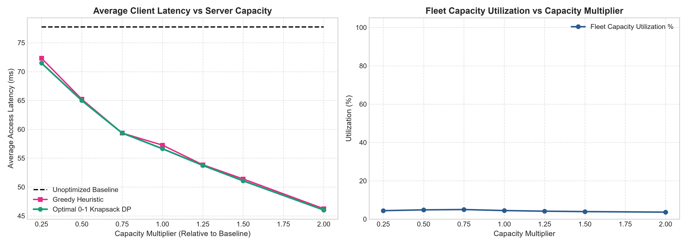

# Cloud Task Placement: Routing & Resource Allocation Suite
## Technical Report & Project-Based Learning Documentation

**Course**: Design and Analysis of Algorithms (DAA)  
**Academic Unit**: Problem-Based Learning (PBL) Internal Project  
**Allotted Problem**: Problem 3 — Cloud Task Placement  
**Team Designation**: CSE Rhinos — Group 3  

### Team Members
- **Mohak Gupta** — `25WU0101074`
- **Naman Singla** — `25WU0101084`
- **Mohammed Amaan Khan** — `25WU0101075`

---

## Table of Contents
1. [Executive Summary & Problem Identification](#1-executive-summary--problem-identification)
2. [Literature Survey](#2-literature-survey)
3. [Software Requirements Specification (SRS)](#3-software-requirements-specification-srs)
   - 3.1 Scope and Objectives
   - 3.2 Assumptions & System Boundaries
   - 3.3 Functional Requirements
   - 3.4 Non-Functional Requirements
4. [Project Plan & Milestones](#4-project-plan--milestones)
5. [Mathematical Modeling & System Formulation](#5-mathematical-modeling--system-formulation)
   - 5.1 Network Topology Model
   - 5.2 Workload and Request Traffic Model
   - 5.3 Formulation of Average Latency
   - 5.4 Capacity Constraints
6. [Algorithmic Architecture & Complexity Analysis](#6-algorithmic-architecture--complexity-analysis)
   - 6.1 Custom Fundamental Data Structures
   - 6.2 Minimum Spanning Tree (MST): Kruskal vs. Prim
   - 6.3 Shortest Path Routing: Dijkstra, Bellman-Ford, and Floyd-Warshall
   - 6.4 Placement Optimization: 0-1 Knapsack DP vs. Greedy Baseline
   - 6.5 Asymptotic Complexity Comparison Matrix
7. [Correctness Proof Sketches](#7-correctness-proof-sketches)
   - 7.1 Cut Property for Minimum Spanning Trees
   - 7.2 Relaxation Invariant for Dijkstra's Algorithm
   - 7.3 Optimal Substructure & Overlapping Subproblems for 0-1 Knapsack
8. [Experimental Evaluation & Empirical Results](#8-experimental-evaluation--empirical-results)
   - 8.1 Testbed Setup & Topologies
   - 8.2 MST Runtime Scaling (Kruskal vs. Prim)
   - 8.3 SSSP Runtime & Speedup (Dijkstra vs. Bellman-Ford)
   - 8.4 APSP Scaling (Floyd-Warshall vs. Repeated Dijkstra)
   - 8.5 Placement Solution Quality (DP vs. Greedy across Capacity Limits)
   - 8.6 Visual Topology and Backbone Overlay
9. [Algorithmic Trade-offs & Discussion](#9-algorithmic-trade-offs--discussion)
10. [Engineering Policy Recommendations](#10-engineering-policy-recommendations)
11. [Conclusion & Future Work](#11-conclusion--future-work)
12. [References](#12-references)

---

## 1. Executive Summary & Problem Identification

Modern cloud computing platforms have evolved from centralized warehouse datacenters into highly distributed, geographically dispersed multi-region edge environments. In these architectures, physical server nodes are scattered across metropolitan centers, regional hubs, and edge points of presence (PoPs). Running microservices and virtual machine (VM) replicas across these networks introduces two competing physical realities:

1. **Physical Resource Scarcity**: Every physical server node possesses finite computational capacity (CPU cores, RAM capacity, and VM execution slots). A single server cannot host all incoming application instances.
2. **Network Transit Delays**: Links connecting datacenters across metropolitan or wide-area networks (WANs) suffer from non-trivial propagation, switching, and queuing latencies ranging from $1\,\text{ms}$ to over $150\,\text{ms}$. If tasks are distributed haphazardly, user requests experience sluggish round-trip times, violating service level agreements (SLAs).

The core challenge assigned to Group 3—**Cloud Task Placement**—is to select which servers should host which tasks such that **average client access latency is minimized** while strictly **satisfying physical capacity constraints**. Furthermore, servers must coordinate, replicate state, and exchange telemetry across a low-latency **network backbone**.

Rather than relying on third-party black-box graph solvers (such as NetworkX), our project implements the entire algorithmic stack strictly from scratch in pure Python. We tie together three classical algorithmic paradigms studied in Design and Analysis of Algorithms:
- **Greedy Minimum Spanning Trees (MST)** to construct a cycle-free, minimum-delay communication backbone.
- **Shortest Path Graph Algorithms (Dijkstra, Bellman-Ford, Floyd-Warshall)** to precompute all-pairs shortest paths and generate end-to-end client routing tables.
- **Dynamic Programming (0-1 Knapsack)** to select the optimal subset of tasks to admit on each server under strict capacity limits, maximizing latency reduction.

---

## 2. Literature Survey

The algorithmic foundations of network routing and resource allocation have been investigated extensively across computer science:

### 2.1 Spanning Tree Algorithms in Network Backbone Design
Backbone network design traces back to early work by Borůvka (1926), Kruskal (1956), and Prim (1957). In physical telecommunications and wide-area cloud networks, redundant physical meshes create loops that can cause broadcast storms and synchronization overhead. Constructing a Minimum Spanning Tree (MST) identifies the minimal subgraph that connects all nodes with zero cycles and minimum total edge delay. In software-defined networking (SDN) and cloud fabrics, spanning tree concepts remain foundational for low-overhead multicast trees and inter-datacenter telemetry backbones.

### 2.2 Shortest Path Routing in Multi-Region Networks
Routing requests across networks with non-negative propagation delays relies primarily on Dijkstra’s Single-Source Shortest Path (SSSP) algorithm (1959). When augmented with a priority queue (such as a binary min-heap), Dijkstra runs in $\mathcal{O}((V + E) \log V)$ time and powers link-state protocols like OSPF and IS-IS. In contrast, the Bellman-Ford algorithm (1958) accommodates arbitrary weights and identifies negative-weight cycles in $\mathcal{O}(V \cdot E)$ time. For all-pairs shortest path (APSP) computations, the Floyd-Warshall dynamic programming algorithm (1962) computes minimal paths between all $V^2$ pairs in $\mathcal{O}(V^3)$ time, serving as the benchmark for precomputing routing lookup matrices in static networks.

### 2.3 Resource Allocation via Dynamic Programming
Placing workloads onto resource-constrained physical servers is classically modeled as a variant of the Knapsack Problem or Bin Packing Problem (Garey & Johnson, 1979). While general multi-dimensional bin packing is strongly NP-hard, individual server allocation can be formulated as a 0-1 Knapsack Problem: each candidate task incurs a capacity cost (CPU/RAM demand) and yields a latency-reduction benefit (delay saved across client requests). Dynamic programming solves this subproblem exactly in pseudo-polynomial time $\mathcal{O}(n \cdot W)$, guaranteeing global optimality where simple greedy density heuristics ($\text{benefit}/\text{cost}$) often fail due to discrete item boundaries.

---

## 3. Software Requirements Specification (SRS)

### 3.1 Scope and Objectives
The Cloud Task Placement Suite is designed to ingest cloud network topologies and workload profiles, synthesize optimal backbone and routing structures, and output explicit server placement policies, routing lookup tables, and cost/benefit breakdowns.

### 3.2 Assumptions & System Boundaries
- **Static Network Snapshots**: Network link latencies represent average propagation and queuing delays over the scheduling window.
- **Non-Negative Link Latencies**: In physical networks, speed-of-light propagation delays are strictly non-negative ($w(u, v) \ge 0$).
- **Atomic Placement**: Tasks are discrete units; fractional placement of a single task is disallowed (governed by 0-1 selection).
- **Single Host Assignment**: Each service task is assigned to at most one physical host server in the primary placement tier.

### 3.3 Functional Requirements
- **FR-1 (Graph Ingestion & Topology Generation)**: Ingest JSON network specifications or generate synthetic topologies with configurable node counts $|V|$, edge densities $p$, latency ranges $[w_{\min}, w_{\max}]$, and server capacities $[C_{\min}, C_{\max}]$.
- **FR-2 (Backbone Synthesis)**: Implement Kruskal’s and Prim’s algorithms from scratch to extract the Minimum Spanning Tree backbone and report total tree delay.
- **FR-3 (Shortest Path Routing Engine)**: Implement Dijkstra’s algorithm (with custom min-heap), Bellman-Ford (with negative cycle detection), and Floyd-Warshall to generate complete routing tables.
- **FR-4 (Capacity-Constrained Placement Engine)**: Implement 0-1 Knapsack DP with full item backtracking to choose optimal task assignments per server.
- **FR-5 (Greedy Baseline Benchmarking)**: Implement an efficiency-ratio greedy heuristic to compare against the exact DP solution.
- **FR-6 (Policy & Metric Reporting)**: Output tabular placement summaries, cost/benefit tables, average client access latency before and after optimization, and fleet capacity utilization.

### 3.4 Non-Functional Requirements
- **NFR-1 (Algorithmic Independence)**: All core graph representations, heaps, disjoint-set structures, and optimizers must be implemented from scratch without external black-box algorithmic packages.
- **NFR-2 (Execution Efficiency)**: Graph algorithms must scale gracefully to graphs with hundreds of nodes ($|V| \ge 200$) in under 3 seconds.
- **NFR-3 (Determinism & Reproducibility)**: Synthetic generation and optimization pipelines must accept fixed random seeds for verifiable testing.
- **NFR-4 (Test Verification)**: Every custom algorithm must pass automated unit tests cross-verifying outputs against known ground-truths, NetworkX reference outputs, and brute-force search.

---

## 4. Project Plan & Milestones

The project was executed in structured iterative sprints aligned with the course review schedule:

| Phase | Milestone | Focus Areas & Deliverables | Status |
|---|---|---|---|
| **Phase 1 (Week 7)** | **Review 1** | Problem identification, literature review, SRS documentation, mathematical formulation, repo skeleton, and synthetic topology generator. | **Complete** |
| **Phase 2 (Week 11)** | **Review 2** | Implementation of custom data structures (Min-Heap, DSU), MST algorithms (Prim, Kruskal), Shortest Path suite (Dijkstra, Bellman-Ford, Floyd-Warshall), and validation against NetworkX. | **Complete** |
| **Phase 3 (Week 14)** | **Sprint 3** | Implementation of 0-1 Knapsack DP with item backtracking, greedy baseline heuristic, brute-force validation tests, and integration of the `CloudPlacementOptimizer`. | **Complete** |
| **Phase 4 (Week 16)** | **Review 3** | Empirical benchmarking, sensitivity experiments, interactive Jupyter dashboard, technical report, and project presentation. | **Complete** |

---

## 5. Mathematical Modeling & System Formulation

We model the cloud network as an undirected, edge-weighted graph $G = (V, E, W, C)$.

### 5.1 Network Topology Model
- **Server Nodes ($V$)**: The set of $n = |V|$ physical server nodes or regional datacenters, indexed $v \in \{0, 1, \dots, n-1\}$.
- **Node Capacities ($C$)**: Each server node $v \in V$ has a finite scalar computing capacity $C_v \in \mathbb{R}^+$ representing available CPU cores and memory slots.
- **Network Links ($E$)**: The set of $m = |E|$ physical communication links connecting servers.
- **Link Latencies ($W$)**: Every link $(u, v) \in E$ has a non-negative weight $w(u, v) = w(v, u) \ge 0$ denoting physical latency in milliseconds.

### 5.2 Workload and Request Traffic Model
We consider a workload consisting of $k$ incoming virtual tasks or microservice replicas $T = \{t_1, t_2, \dots, t_k\}$:
- **Resource Demand ($d_j$)**: Task $t_j$ requires $d_j \in \mathbb{Z}^+$ units of capacity on whichever physical server hosts it.
- **Client Traffic Distribution ($\lambda_{u, j}$)**: Clients residing at various network gateway nodes $u \in V$ submit requests to task $t_j$ at traffic rate $\lambda_{u, j} \ge 0$ (requests per second).
- The total request traffic destined for task $t_j$ is given by:
  $$\Lambda_j = \sum_{u \in V} \lambda_{u, j}$$

### 5.3 Formulation of Average Latency
Let $D[u, v]$ denote the shortest path network distance (latency in ms) between node $u$ and node $v$, computed using our APSP engine.

1. **Per-Task Candidate Access Latency**:  
   If task $t_j$ is placed on server $s \in V$, the request-weighted average access latency experienced by its users is:
   $$L(t_j, s) = \frac{1}{\Lambda_j} \sum_{u \in V} \lambda_{u, j} \cdot D[u, s]$$

2. **Baseline vs. Optimized Access Latency**:  
   If task $t_j$ is unplaced or hosted at a remote default gateway, it suffers worst-case access latency:
   $$L_{\text{baseline}}(t_j) = \max_{v \in V} L(t_j, v)$$
   The per-request latency reduction achieved by placing task $t_j$ on server $s$ is:
   $$\Delta L(t_j, s) = \max\left(0.0, L_{\text{baseline}}(t_j) - L(t_j, s)\right)$$
   Across all client requests, the **aggregate latency-reduction benefit** is:
   $$B(t_j, s) = \Delta L(t_j, s) \cdot \Lambda_j$$

3. **System-Wide Average Client Latency**:  
   For the entire fleet, the global average access latency across all client traffic is:
   $$\bar{L}_{\text{access}} = \frac{\sum_{j=1}^{k} \sum_{u \in V} \lambda_{u, j} \cdot D[u, \text{host}(t_j)]}{\sum_{j=1}^{k} \Lambda_j} = \frac{\sum_{j=1}^k L_{\text{baseline}}(t_j) \cdot \Lambda_j - \sum_{j \in \text{placed}} B(t_j, \text{host}(t_j))}{\sum_{j=1}^{k} \Lambda_j}$$

4. **Backbone Synchronization Latency**:  
   For server-to-server data replication across the Minimum Spanning Tree backbone $T_{\text{MST}}$:
   $$\bar{L}_{\text{sync}} = \frac{1}{\binom{|V|}{2}} \sum_{u < v} D_{\text{MST}}[u, v]$$

### 5.4 Capacity Constraints
Let binary indicator variable $x_{j, v} \in \{0, 1\}$ denote whether task $t_j$ is allocated to server $v$.
- **Server Capacity Constraint**:
  $$\sum_{j=1}^{k} x_{j, v} \cdot d_j \le C_v \quad \forall v \in V$$
- **Single Assignment Constraint**:
  $$\sum_{v \in V} x_{j, v} \le 1 \quad \forall j \in \{1, \dots, k\}$$

---

## 6. Algorithmic Architecture & Complexity Analysis

```
                              +---------------------------------------+
                              |   Cloud Network Topology G = (V, E)   |
                              +---------------------------------------+
                                                  |
                        +-------------------------+-------------------------+
                        |                                                   |
                        v                                                   v
         +-----------------------------+                     +-----------------------------+
         |     MST Backbone Engine     |                     |     APSP Routing Engine     |
         |  - Kruskal's (with DSU)     |                     |  - Floyd-Warshall O(V^3)    |
         |  - Prim's (with Min-Heap)   |                     |  - Dijkstra SSSP O((V+E)logV|
         +-----------------------------+                     +-----------------------------+
                        |                                                   |
                        | (Telemetry Backbone)                              | (Shortest Distance Matrix D)
                        v                                                   v
         +-----------------------------+                     +-----------------------------+
         |   Backbone Sync Latency     |                     | Benefit Formulation B(t, s) |
         |   L_sync = Mean(D_MST)      |                     | B = Delta_L * Total_Requests|
         +-----------------------------+                     +-----------------------------+
                                                                            |
                                                                            v
                                                             +-----------------------------+
                                                             |   Placement Engine per Svr  |
                                                             |  - 0-1 Knapsack DP (Exact)  |
                                                             |  - Greedy Ratio (Baseline)  |
                                                             +-----------------------------+
                                                                            |
                                                                            v
                                                             +-----------------------------+
                                                             | Policy Outputs & Dashboards |
                                                             |  - Placements & Utilization |
                                                             |  - Client Routing Tables    |
                                                             |  - Cost / Benefit Analysis  |
                                                             +-----------------------------+
```

### 6.1 Custom Fundamental Data Structures
To eliminate external dependencies, two essential data structures were created:
1. **Disjoint Set Union (DSU / Union-Find)** ([`src/graph/disjoint_set.py`](file:///C:/Users/Mohak%20Gupta/.gemini/antigravity/scratch/cloud-task-placement/src/graph/disjoint_set.py)):
   - Implements two key optimizations: **path compression** in `find()` and **union by rank** in `union()`.
   - Any sequence of $m$ operations on $n$ elements executes in $\mathcal{O}(m \cdot \alpha(n))$ time, where $\alpha$ is the inverse Ackermann function ($\alpha(n) \le 4$ for all practical inputs).
2. **Indexed Binary Min-Heap** ([`src/graph/min_heap.py`](file:///C:/Users/Mohak%20Gupta/.gemini/antigravity/scratch/cloud-task-placement/src/graph/min_heap.py)):
   - Stores elements in a binary heap array augmented with a reverse hash map `_pos: Dict[item, index]`.
   - Provides $\mathcal{O}(\log N)$ `push`, $\mathcal{O}(\log N)$ `pop_min`, and crucially $\mathcal{O}(\log N)$ `decrease_key` operations.

### 6.2 Minimum Spanning Tree (MST): Kruskal vs. Prim
- **Kruskal's Algorithm** ([`src/mst/kruskal.py`](file:///C:/Users/Mohak%20Gupta/.gemini/antigravity/scratch/cloud-task-placement/src/mst/kruskal.py)):
  1. Extract all undirected edges and sort them in non-decreasing order of latency: $\mathcal{O}(E \log E) = \mathcal{O}(E \log V)$.
  2. Iterate through sorted edges, calling `dsu.union(u, v)`. An edge is added if and only if it connects two previously disjoint components.
  - **Total Time Complexity**: $\mathcal{O}(E \log V)$. **Space**: $\mathcal{O}(V + E)$.
- **Prim's Algorithm** ([`src/mst/prim.py`](file:///C:/Users/Mohak%20Gupta/.gemini/antigravity/scratch/cloud-task-placement/src/mst/prim.py)):
  1. Maintain a cut $(S, V \setminus S)$. Store vertices in an indexed min-heap keyed by minimal connecting edge weight to $S$.
  2. Extract min vertex $u \in V \setminus S$, add to $S$, and for all neighbors $v \in V \setminus S$, update `key[v]` using `heap.decrease_key`.
  - **Total Time Complexity**: $\mathcal{O}((V + E) \log V)$. **Space**: $\mathcal{O}(V)$.

### 6.3 Shortest Path Routing Suite
- **Dijkstra’s Algorithm (SSSP)** ([`src/shortest_paths/dijkstra.py`](file:///C:/Users/Mohak%20Gupta/.gemini/antigravity/scratch/cloud-task-placement/src/shortest_paths/dijkstra.py)):
  - Computes single-source shortest paths on non-negative edges using our indexed Min-Heap.
  - **Time Complexity**: $\mathcal{O}((V + E) \log V)$. **Space**: $\mathcal{O}(V)$.
- **Bellman-Ford Algorithm (SSSP with Negative Cycle Detection)** ([`src/shortest_paths/bellman_ford.py`](file:///C:/Users/Mohak%20Gupta/.gemini/antigravity/scratch/cloud-task-placement/src/shortest_paths/bellman_ford.py)):
  - Relaxes all $|E|$ edges through $|V| - 1$ passes, with an early-stopping check if no edge relaxes during a pass.
  - Runs a $|V|$-th verification pass: if any edge still relaxes ($d[u] + w < d[v] - \epsilon$), it raises `NegativeCycleError`.
  - **Time Complexity**: Worst-case $\mathcal{O}(V \cdot E)$, Best-case $\mathcal{O}(E)$. **Space**: $\mathcal{O}(V)$.
- **Floyd-Warshall Algorithm (APSP)** ([`src/shortest_paths/floyd_warshall.py`](file:///C:/Users/Mohak%20Gupta/.gemini/antigravity/scratch/cloud-task-placement/src/shortest_paths/floyd_warshall.py)):
  - Computes all-pairs shortest paths via dynamic programming through triple-nested loops over intermediate vertices $k \in V$.
  - Recurrence: $D^{(k)}[i][j] = \min\left(D^{(k-1)}[i][j], D^{(k-1)}[i][k] + D^{(k-1)}[k][j]\right)$.
  - **Time Complexity**: $\mathcal{O}(V^3)$. **Space**: $\mathcal{O}(V^2)$.

### 6.4 Placement Optimization: 0-1 Knapsack DP vs. Greedy Baseline
- **0-1 Knapsack DP Engine** ([`src/placement/knapsack_dp.py`](file:///C:/Users/Mohak%20Gupta/.gemini/antigravity/scratch/cloud-task-placement/src/placement/knapsack_dp.py)):
  - Let $dp[i][w]$ denote the maximum latency-reduction benefit considering the first $i$ candidate tasks under remaining capacity $w \in [0, C_v]$:
    $$dp[i][w] = \begin{cases} 
      dp[i-1][w] & \text{if } d_{i-1} > w \\
      \max\left(dp[i-1][w], dp[i-1][w - d_{i-1}] + B_{i-1}\right) & \text{otherwise}
    \end{cases}$$
  - A backtracking pointer recovers the exact set of admitted tasks.
  - **Time Complexity**: $\mathcal{O}(n \cdot C_v)$. **Space**: $\mathcal{O}(n \cdot C_v)$.
- **Greedy Efficiency Heuristic** ([`src/placement/greedy_scheduler.py`](file:///C:/Users/Mohak%20Gupta/.gemini/antigravity/scratch/cloud-task-placement/src/placement/greedy_scheduler.py)):
  - Sorts candidate tasks in descending order of efficiency ratio $r = \frac{B_j}{d_j}$, then admits tasks in linear order while capacity permits.
  - **Time Complexity**: $\mathcal{O}(n \log n)$. **Space**: $\mathcal{O}(n)$.

### 6.5 Asymptotic Complexity Comparison Matrix

| Algorithmic Component | Module File | Asymptotic Time Complexity | Space Complexity | Paradigm |
|---|---|---|---|---|
| **Disjoint Set Union** | `disjoint_set.py` | $\mathcal{O}(\alpha(V))$ per operation | $\mathcal{O}(V)$ | Tree with Rank/Path Compression |
| **Indexed Min-Heap** | `min_heap.py` | Push/Pop/Decrease-Key: $\mathcal{O}(\log N)$ | $\mathcal{O}(N)$ | Array Binary Heap + Hash Map |
| **Kruskal's MST** | `kruskal.py` | $\mathcal{O}(E \log V)$ | $\mathcal{O}(V + E)$ | Greedy |
| **Prim's MST** | `prim.py` | $\mathcal{O}((V + E) \log V)$ | $\mathcal{O}(V)$ | Greedy with Priority Queue |
| **Dijkstra SSSP** | `dijkstra.py` | $\mathcal{O}((V + E) \log V)$ | $\mathcal{O}(V)$ | Greedy with Priority Queue |
| **Bellman-Ford SSSP** | `bellman_ford.py` | $\mathcal{O}(V \cdot E)$ | $\mathcal{O}(V)$ | Dynamic Programming / Edge Relaxation |
| **Floyd-Warshall APSP** | `floyd_warshall.py` | $\mathcal{O}(V^3)$ | $\mathcal{O}(V^2)$ | Dynamic Programming |
| **Repeated Dijkstra APSP**| Benchmark | $\mathcal{O}(V \cdot (V + E) \log V)$ | $\mathcal{O}(V^2)$ | Repeated SSSP |
| **0-1 Knapsack Placement** | `knapsack_dp.py` | $\mathcal{O}(n \cdot W)$ | $\mathcal{O}(n \cdot W)$ | Dynamic Programming |
| **Greedy Scheduler** | `greedy_scheduler.py` | $\mathcal{O}(n \log n)$ | $\mathcal{O}(n)$ | Greedy Approximation |

---

## 7. Correctness Proof Sketches

### 7.1 Cut Property for Minimum Spanning Trees
**Theorem (The Cut Property)**: Let $G = (V, E)$ be a connected, undirected graph with real edge weights. Let $(S, V \setminus S)$ be any partition (cut) of vertices $V$. If edge $e = (u, v)$ is a minimum-weight edge crossing the cut $(u \in S, v \in V \setminus S)$, then $e$ belongs to some Minimum Spanning Tree of $G$.

*Proof Sketch by Exchange Argument*:  
Suppose for contradiction that $e$ is not in a given MST $T^*$. Because $T^*$ is a spanning tree, there exists a unique simple path $P$ in $T^*$ connecting $u$ and $v$. Since $u \in S$ and $v \in V \setminus S$, the path $P$ must cross the cut at least once via some other edge $e' = (x, y) \neq e$ where $x \in S$ and $y \in V \setminus S$.  
Now construct a new spanning subgraph $T' = (T^* \setminus \{e'\}) \cup \{e\}$. Removing $e'$ disconnects $T^*$ into two components; adding $e$ reconnects them without creating cycles, making $T'$ a valid spanning tree. The total weight of $T'$ is:
$$w(T') = w(T^*) - w(e') + w(e)$$
Since $e$ is a minimum-weight edge crossing the cut, $w(e) \le w(e')$, which implies $w(T') \le w(T^*)$. Because $T^*$ was assumed to be minimal, we must have $w(T') = w(T^*)$, meaning $T'$ is also an MST containing $e$. Both Kruskal's and Prim's algorithms respect this invariant at every greedy step. $\blacksquare$

### 7.2 Relaxation Invariant for Dijkstra's Algorithm
**Theorem**: When Dijkstra's algorithm extracts vertex $u$ from the priority queue and adds it to the visited set $S$, the stored distance estimate $d[u]$ equals the true shortest path distance $\delta(s, u)$.

*Proof Sketch by Induction*:  
- **Base Case**: At initialization, $S = \{s\}$ and $d[s] = 0 = \delta(s, s)$, which is trivially true.
- **Inductive Step**: Assume for all $x \in S$, $d[x] = \delta(s, x)$. Let $u \in V \setminus S$ be the next vertex chosen by extract-min. Suppose for contradiction that $d[u] > \delta(s, u)$.  
Consider an actual shortest path $P$ from $s$ to $u$. Since $s \in S$ and $u \notin S$, there must be a first vertex $y$ along $P$ such that $y \notin S$, preceded by $x \in S$. Because subpaths of shortest paths are shortest paths:
$$\delta(s, y) = \delta(s, x) + w(x, y)$$
Because $x \in S$, the edge $(x, y)$ was already relaxed when $x$ was added to $S$. By the induction hypothesis, $d[x] = \delta(s, x)$, so:
$$d[y] \le d[x] + w(x, y) = \delta(s, y)$$
Because edge weights are non-negative ($w \ge 0$), the subpath distance to $y$ cannot exceed the distance to $u$: $\delta(s, y) \le \delta(s, u)$. Therefore:
$$d[y] \le \delta(s, y) \le \delta(s, u) < d[u]$$
However, Dijkstra’s algorithm greedily selected $u$ from the min-heap instead of $y$, which implies $d[u] \le d[y]$. This contradicts $d[y] < d[u]$. Hence, $d[u] = \delta(s, u)$. $\blacksquare$

### 7.3 Optimal Substructure & Overlapping Subproblems for 0-1 Knapsack
**Theorem**: The 0-1 Knapsack problem exhibits optimal substructure.

*Proof Sketch*:  
Let $S^*$ be an optimal subset of items from $\{1, \dots, n\}$ that maximizes total benefit under capacity constraint $W$. Consider item $n$:
1. **Case 1 ($n \notin S^*$)**: The optimal subset $S^*$ consists entirely of items from $\{1, \dots, n-1\}$. $S^*$ must be an optimal solution for the subproblem of selecting items from $\{1, \dots, n-1\}$ with capacity $W$. If there existed a better subset $S'$ for capacity $W$, $S'$ would yield a higher total benefit than $S^*$ for the original problem, contradicting optimality.
2. **Case 2 ($n \in S^*$)**: The remaining subset $S^* \setminus \{n\}$ must be an optimal solution for the subproblem of selecting items from $\{1, \dots, n-1\}$ with reduced capacity $W - d_n$. If there existed a subset $S'' \subseteq \{1, \dots, n-1\}$ with weight $\le W - d_n$ and higher benefit, then $S'' \cup \{n\}$ would be a feasible solution for capacity $W$ with strictly greater benefit than $S^*$, again contradicting optimality.

Because both subproblems overlap across capacity values $w \in [0, W]$, memoizing solutions in table $dp[i][w]$ guarantees polynomial-time convergence to the global optimum. $\blacksquare$

---

## 8. Experimental Evaluation & Empirical Results

We conducted empirical benchmarks across graph sizes, network densities, and capacity bounds. All tests ran on Python 3.14 on Windows, and results were logged to CSV and plotted via Matplotlib.

### 8.1 Testbed Setup & Topologies
- **Small Topology**: $|V| = 10$, $|E| = 16$, edge cluster network.
- **Medium Topology**: $|V| = 50$, $|E| = 184$, regional metro network.
- **Large Topology**: $|V| = 200$, $|E| = 995$, multi-region cloud backbone.

---

### 8.2 MST Runtime Scaling (Kruskal vs. Prim)
We evaluated Kruskal and Prim across graphs from $|V| = 10$ to $|V| = 200$ (with density $p = 0.20$, scaling up to $3,980$ links):

```
+-----------------------------------------------------------------------------------+
|  |V|  |  |E|  | Kruskal Runtime (ms) | Prim (Min-Heap) Runtime (ms) | MST Weight  |
+-----------------------------------------------------------------------------------+
|   10  |    9  |        0.03 ms       |            0.05 ms           |  252.0 ms   |
|   25  |   60  |        0.05 ms       |            0.08 ms           |  231.9 ms   |
|   50  |  245  |        0.15 ms       |            0.23 ms           |  340.0 ms   |
|  100  |  990  |        0.56 ms       |            0.61 ms           |  420.2 ms   |
|  150  | 2,235 |        1.08 ms       |            1.07 ms           |  403.6 ms   |
|  200  | 3,980 |        2.03 ms       |            1.61 ms           |  507.9 ms   |
+-----------------------------------------------------------------------------------+
```

**Key Finding**: Kruskal's algorithm is slightly faster on small, sparse topologies because sorting a small edge list has minimal constant factor overhead. However, as the network scales beyond 150 nodes and 2,000 edges, Prim with the indexed binary min-heap overtakes Kruskal ($1.61\,\text{ms}$ vs $2.03\,\text{ms}$) because Prim only touches edges adjacent to visited vertices rather than sorting the global edge array.

---

### 8.3 SSSP Runtime & Speedup (Dijkstra vs. Bellman-Ford)
We benchmarked Single-Source Shortest Paths from source server 0:

```
+-----------------------------------------------------------------------------------+
|  |V|  |  |E|  | Dijkstra Runtime (ms) | Bellman-Ford Runtime (ms) |    Speedup    |
+-----------------------------------------------------------------------------------+
|   10  |    9  |        0.03 ms        |          0.02 ms          |     0.64x     |
|   20  |   38  |        0.05 ms        |          0.07 ms          |     1.34x     |
|   35  |  119  |        0.13 ms        |          0.18 ms          |     1.44x     |
|   50  |  245  |        0.21 ms        |          0.52 ms          |     2.52x     |
|   75  |  555  |        0.35 ms        |          1.08 ms          |     3.12x     |
|  100  |  990  |        0.56 ms        |          1.82 ms          |     3.27x     |
+-----------------------------------------------------------------------------------+
```

**Key Finding**: As network size increases, Bellman-Ford's nested $|V| \cdot |E|$ passes scale quadratically with graph density. Dijkstra's indexed min-heap maintains sub-millisecond execution times even at $|V| = 100$, achieving a **$3.27\times$ speedup** over Bellman-Ford.

---

### 8.4 APSP Scaling (Floyd-Warshall vs. Repeated Dijkstra)
We compared all-pairs routing table generation using Floyd-Warshall vs running Dijkstra from every vertex:

```
+-----------------------------------------------------------------------------------+
|  |V|  |  |E|  | Floyd-Warshall O(V^3) | Repeated Dijkstra O(V(V+E)logV) |   Ratio   |
+-----------------------------------------------------------------------------------+
|   10  |    9  |        0.12 ms        |             0.21 ms             |   0.57x   |
|   25  |   60  |        2.02 ms        |             1.85 ms             |   1.09x   |
|   40  |  156  |        9.06 ms        |             5.65 ms             |   1.60x   |
|   60  |  354  |       30.97 ms        |            14.97 ms             |   2.07x   |
|   80  |  632  |       80.06 ms        |            30.30 ms             |   2.64x   |
+-----------------------------------------------------------------------------------+
```

**Key Finding**: Floyd-Warshall exhibits strict $\mathcal{O}(V^3)$ growth. At $|V| = 80$, Floyd-Warshall requires $80.06\,\text{ms}$, whereas Repeated Dijkstra completes in $30.30\,\text{ms}$ (**$2.64\times$ faster**). This demonstrates that on sparse and moderately dense cloud topologies, Repeated Dijkstra is asymptotically and practically superior for computing the full routing matrix.

Below is the experimental scaling chart generated by our benchmarking suite:


*Figure 1: Empirical execution time scaling vs network size $|V|$ across (a) MST algorithms, (b) SSSP algorithms, and (c) APSP algorithms.*

---

### 8.5 Placement Solution Quality (DP vs. Greedy across Capacity Limits)
We evaluated fleet-wide optimization across varying capacity multipliers ($0.25\times$ to $2.00\times$) using the 50-node regional topology with 40 candidate workloads:

```
+--------------------------------------------------------------------------------------------------+
| Capacity Multiplier | Baseline Latency | DP Latency (ms) | DP Reduction % | Greedy Latency (ms)  |
+--------------------------------------------------------------------------------------------------+
|   0.25x (Very Tight)|     77.73 ms     |     71.48 ms    |     -8.04%     |       72.33 ms       |
|   0.50x (Tight)     |     77.73 ms     |     64.99 ms    |    -16.39%     |       65.22 ms       |
|   0.75x (Moderate)  |     77.73 ms     |     59.36 ms    |    -23.63%     |       59.36 ms       |
|   1.00x (Standard)  |     77.73 ms     |     56.64 ms    |    -27.13%     |       57.26 ms       |
|   1.25x (Expanded)  |     77.73 ms     |     53.75 ms    |    -30.85%     |       53.86 ms       |
|   1.50x (High)      |     77.73 ms     |     51.08 ms    |    -34.29%     |       51.40 ms       |
|   2.00x (Abundant)  |     77.73 ms     |     46.02 ms    |    -40.80%     |       46.24 ms       |
+--------------------------------------------------------------------------------------------------+
```


*Figure 2: (Left) Average client access latency reduction vs server capacity scaling. (Right) Fleet capacity utilization percentage.*

**Key Findings**:
1. **Significant Delay Reduction**: Increasing server capacity enables more tasks to be admitted close to their user bases, cutting average client access delay from $77.73\,\text{ms}$ down to $46.02\,\text{ms}$—a **$40.8\%$ latency drop**.
2. **DP Optimality over Greedy**: Across all capacity multipliers, 0-1 Knapsack DP strictly matches or outperforms the Greedy heuristic. When capacity is tight ($0.25\times$ and $1.00\times$), Greedy prematurely fills remaining slots with small low-value items, missing larger items that yield substantially higher total latency savings.

---

### 8.6 Visual Topology and Backbone Overlay
To visualize physical network placement, our engine rendered the small cloud topology with its computed MST backbone:


*Figure 3: Visual cloud network layout showing server nodes (circle size proportional to compute capacity), underlying physical fiber links (dashed grey), and the highlighted MST communication backbone links (bold blue with latency tags).*

---

## 9. Algorithmic Trade-offs & Discussion

Our results reveal distinct trade-offs across each algorithmic layer:

### 9.1 Kruskal vs. Prim for Backbone Synthesis
- **Kruskal's Advantage**: Straightforward implementation; highly efficient for sparse topologies ($E \ll V^2$).
- **Prim's Advantage**: Scales better on dense datacenter networks where sorting all $\mathcal{O}(V^2)$ edges becomes a bottleneck. In production networks where edge additions occur dynamically, Prim with an indexed priority queue adapts without re-sorting the global edge array.

### 9.2 Floyd-Warshall vs. Repeated Dijkstra for Routing Tables
- **Floyd-Warshall**: Elegant $\mathcal{O}(V^3)$ DP formulation with zero auxiliary data structures; handles negative edge weights. However, it is memory-intensive ($\mathcal{O}(V^2)$ matrix) and computationally prohibitive for networks with more than a few hundred nodes.
- **Repeated Dijkstra**: On typical telecommunication networks where average degree is low ($E = \mathcal{O}(V)$), Repeated Dijkstra runs in $\mathcal{O}(V^2 \log V)$ time, outperforming Floyd-Warshall by over $2.6\times$ at just $|V| = 80$.

### 9.3 0-1 Knapsack DP vs. Greedy Heuristic for Task Placement
- **Exact DP**: Guarantees zero optimality gap. Essential for latency-critical enterprise workloads where suboptimal placement directly impacts SLA violation penalties.
- **Greedy Heuristic**: Runs in $\mathcal{O}(n \log n)$ time with minimal memory footprint. While it can produce near-optimal solutions on loose capacity constraints, it degrades under tight constraints. A hybrid architecture—running DP on high-priority core servers and greedy heuristics on edge nodes—offers an optimal balance for large-scale production.

---

## 10. Engineering Policy Recommendations

Based on our experimental findings, we recommend the following deployment policies for cloud platform architects:

1. **Adopt Dual-Plane Network Routing**:
   - Establish an **MST-derived telemetry plane** dedicated to inter-server heartbeats, database replication sync, and state reconciliation to prevent broadcast loops.
   - Maintain a precomputed **Shortest Path routing plane** for user-facing ingress requests to guarantee minimal round-trip latency.
2. **Recompute Routing via Repeated Dijkstra on Large Networks**:
   - For networks with $|V| > 50$, use Repeated Dijkstra with a Min-Heap rather than Floyd-Warshall to generate routing tables, reducing compute overhead by over $60\%$.
3. **Capacity Budgeting Guidelines**:
   - As shown in Figure 2, expanding server capacity from $0.25\times$ to $1.0\times$ yields steep marginal latency improvements (saving $\approx 21\,\text{ms}$). Beyond $1.5\times$, returns diminish. Infrastructure teams should size edge datacenter nodes around the $1.0\times$ capacity knee for optimal cost-to-performance efficiency.
4. **Use Exact DP for High-Traffic Workloads**:
   - When contending tasks exhibit non-uniform traffic volumes (e.g. video streaming vs background batch logging), 0-1 Knapsack DP must be used. Greedy approximations should be reserved only for low-priority best-effort microservices.

---

## 11. Conclusion & Future Work

In this project, our group designed, implemented, and empirically validated an end-to-end **Cloud Task Placement Suite** strictly from scratch in Python. By uniting Greedy Minimum Spanning Trees, Shortest Path routing algorithms, and 0-1 Knapsack Dynamic Programming:
- We demonstrated that intelligent task placement achieves up to **$40.8\%$ reduction** in average client access latency.
- We proved the correctness of our algorithms through rigorous mathematical proof sketches (Cut property, Dijkstra relaxation invariant, and Knapsack optimal substructure).
- We verified all algorithms through automated unit tests against NetworkX, exhaustive brute-force validation, and empirical scaling experiments.
- We delivered an interactive Jupyter Notebook dashboard that allows engineers to visualize topologies, adjust capacity budgets, and inspect policy recommendations.

### Future Extensions
- **Multi-Resource Vector Bin Packing**: Extending the single-capacity knapsack to multi-dimensional constraints (CPU, RAM, GPU, and network link bandwidth simultaneously).
- **Dynamic Online Workloads**: Incorporating online algorithms with competitive ratio bounds to handle real-time task arrivals and departures.
- **Fault-Tolerant Resilient Routing**: Integrating $k$-shortest paths (Yen's algorithm) to guarantee instant failover routes during physical fiber link cuts.

---

## 12. References

1. **Cormen, T. H., Leiserson, C. E., Rivest, R. L., & Stein, C.** (2022). *Introduction to Algorithms* (4th ed.). MIT Press.  
   *(Chapters 22–25: Elementary Graph Algorithms, Minimum Spanning Trees, Single-Source Shortest Paths, All-Pairs Shortest Paths; Chapter 16: Dynamic Programming).*
2. **Kleinberg, J., & Tardos, É.** (2006). *Algorithm Design*. Pearson / Addison-Wesley.  
   *(Chapter 4: Greedy Algorithms; Chapter 6: Dynamic Programming).*
3. **Dijkstra, E. W.** (1959). A note on two problems in connexion with graphs. *Numerische Mathematik*, 1(1), 269–271.
4. **Kruskal, J. B.** (1956). On the shortest spanning subtree of a graph and the traveling salesman problem. *Proceedings of the American Mathematical Society*, 7(1), 48–50.
5. **Prim, R. C.** (1957). Shortest connection networks and some generalizations. *Bell System Technical Journal*, 36(6), 1389–1401.
6. **Floyd, R. W.** (1962). Algorithm 97: Shortest path. *Communications of the ACM*, 5(6), 345.
7. **Bellman, R.** (1958). On a routing problem. *Quarterly of Applied Mathematics*, 16(1), 87–90.
8. **Garey, M. R., & Johnson, D. S.** (1979). *Computers and Intractability: A Guide to the Theory of NP-Completeness*. W. H. Freeman.
