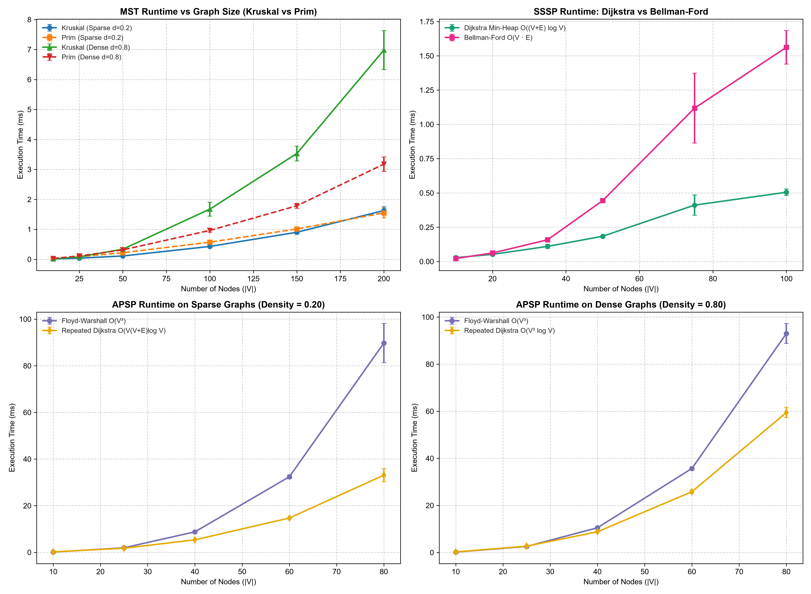
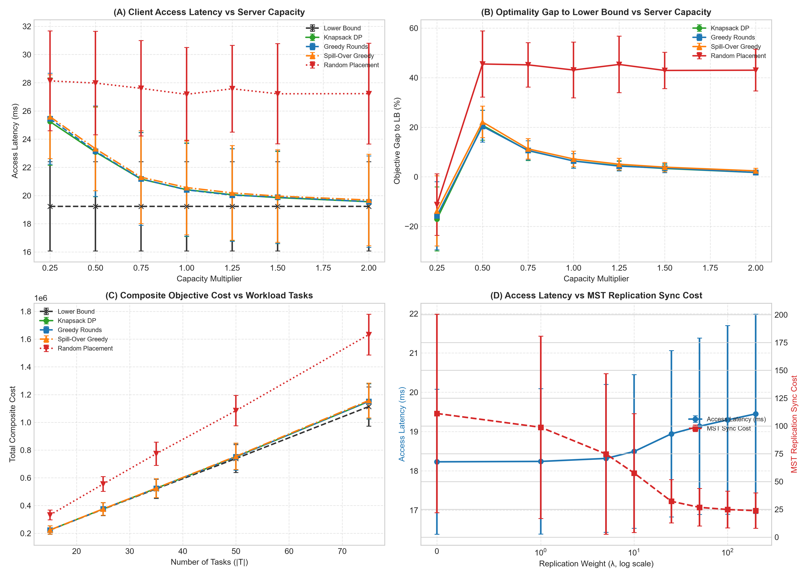
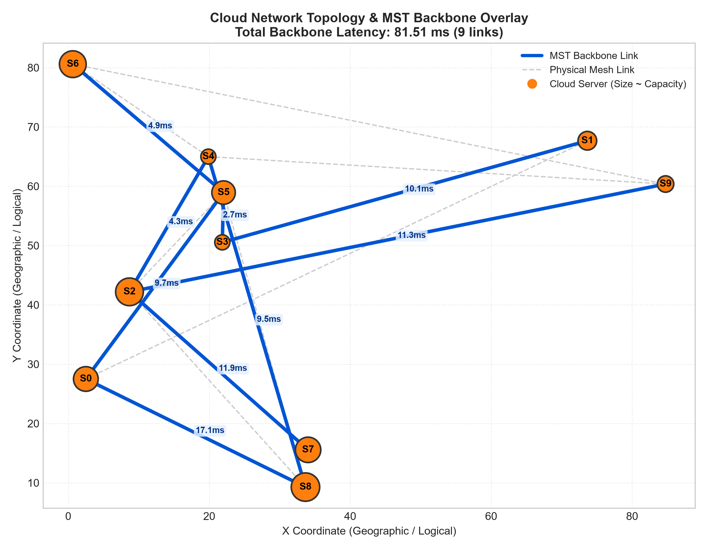

# Cloud Task Placement: Routing & Resource Allocation Suite
## Technical Report: Algorithmic Architecture, Empirical Scaling & Discrete Optimization

**Course**: Design and Analysis of Algorithms (DAA) — Problem-Based Learning (PBL)  
**Assigned Topic**: Problem 3 — Cloud Task Placement  
**Team (Group 3)**:
- Naman Singla (`25WU0101084`)
- Mohak Gupta (`25WU0101074`)
- Mohammed Amaan Khan (`25WU0101075`)

---

## 1. Problem Identification & Motivation

Modern distributed computing environments—spanning multi-region clouds and edge computing clusters—face the fundamental challenge of placing client workloads onto physical infrastructure while balancing physical computing capacity, transit latency, and state replication overhead. When client requests enter the cloud at geographically dispersed ingress gateways, they must be assigned to physical host servers under three strict engineering requirements:

1. **Finite Physical Server Capacity**: Each host $v \in V$ provides finite integer capacity $C_v$; aggregate task demand on $v$ cannot exceed $C_v$.
2. **Physical Routing Latency**: Physical links $(u, v) \in E$ have delays $w(u, v) > 0$; sub-optimal placement degrades end-user QoS.
3. **Distributed Synchronization Overhead**: Stateful replicas must synchronize logs across a dedicated, cycle-free backbone to avoid network congestion.

### 1.1 Algorithmic Scope & Core Objectives
We develop a composite algorithmic pipeline implemented strictly from scratch in pure Python:
- **Backbone Synthesis**: Exact MST via Kruskal / Prim to establish a minimal-cost communication backbone.
- **Shortest Path Routing**: SSSP and APSP matrices via Dijkstra, Bellman-Ford, and Floyd-Warshall.
- **Combinatorial Resource Allocation**: Server-level task selection via 0-1 Knapsack DP with multi-round opportunity regret coordination.

---

## 2. Literature Survey

The challenge of placing service replicas and virtual machines (VMs) close to distributed users while observing infrastructure bounds intersects multiple classical combinatorial optimization domains. The problem is closely related to the **Capacitated Facility Location Problem (CFLP)** and the **$k$-Median Problem**, in which facilities are opened and clients assigned to minimize joint operational and transit costs (Shmoys et al., 1997 `[verify]`; Korte & Vygen, 2018 `[verify]`). In cloud computing, research on traffic-aware virtual machine placement focuses on co-locating communicating services and placing latency-sensitive instances near ingress gateways to reduce core network congestion and SLA violations (Meng et al., 2010 `[verify]`; Karve et al., 2006 `[verify]`). While general multi-server assignment under vector capacity constraints is strongly NP-hard (Garey & Johnson, 1979), decomposing the multi-server coordination problem into iterative bidding rounds allows individual server subproblems to be solved via 0-1 Knapsack Dynamic Programming in pseudo-polynomial time (Cormen et al., 2022).

---

## 3. Software Requirements Specification (SRS)

### 3.1 Functional Requirements (FR)
- **FR1 (Fleet Modeling & Topology Generation)**: Represent physical networks as undirected weighted graphs $G = (V, E)$ supporting integer server capacities $C_v$ and link latencies $w(u, v) > 0$, with JSON serialization and reproducible synthetic generation.
- **FR2 (Backbone Synthesis)**: Identify the exact Minimum Spanning Tree (MST) using from-scratch Kruskal's (with Disjoint Set Union) and Prim's (with custom binary min-heap) algorithms.
- **FR3 (Routing Matrix Precomputation)**: Compute all-pairs shortest paths $D[u, v]$ via Floyd-Warshall and Repeated Dijkstra, and single-source paths via Bellman-Ford (with negative-cycle detection).
- **FR4 (Opportunity Regret & Multi-Round Knapsack Placement)**: Coordinate fleet placement through iterative bidding rounds where oversubscribed servers solve 0-1 Knapsack DP using regret benefit $\Delta J(t_j, s) = J(t_j, s_2) - J(t_j, s_1)$.
- **FR5 (Multi-Strategy Benchmarking)**: Compare Knapsack DP against an Unconstrained Lower Bound, Greedy Rounds, Spill-Over Greedy, Random Placement, and an exact Brute-Force Assignment solver on tiny instances.
- **FR6 (Fleet Metrics & Auditing)**: Report placed and unplaced tasks, fleet-wide capacity utilization, average client access latency, and MST replication sync delay without charging artificial penalties.

### 3.2 Non-Functional Requirements & Boundary Scope
- **NFR1 (Zero External Solvers)**: All graph primitives, min-heaps, DSU, shortest paths, and knapsack DP modules must be implemented strictly from scratch in pure Python.
- **NFR2 (Algorithmic Correctness & Reproducibility)**: Verified via automated unit tests cross-checked against NetworkX and exact combinatorial solvers under fixed random seeds.
- **NFR3 (Computational Scalability)**: Routing and placement subproblems must execute in sub-second times on networks up to $|V| = 200$.
- **Boundary Assumptions**: Workloads represent discrete scheduling epochs; server capacities and task demands are non-negative scalar integers; link latencies are strictly positive and symmetric ($w(u, v) = w(v, u) > 0$); transient router queuing delays and vector packing dimensions (e.g. GPU, I/O) are outside the current scope.

---

## 4. Project Plan & Milestones

The project was executed across six sequential engineering milestones:
1. **Phase 1 (Graph Primitives & Datasets)**: Adjacency-list `Graph`, reproducible topology generator, JSON I/O, unit test framework (*Completed*).
2. **Phase 2 (MST Backbone & Routing Suite)**: Custom `MinHeap`, `DSU`, Kruskal, Prim, Dijkstra, Bellman-Ford, Floyd-Warshall (*Completed*).
3. **Phase 3 (Combinatorial Schedulers & Knapsack DP)**: 0-1 Knapsack DP, Greedy Ratio heuristic, fractional upper bound, tiny brute-force solver (*Completed*).
4. **Phase 4 (Placement Optimizer Pipeline)**: `CloudPlacementOptimizer`, regret benefit bidding rounds, MST sync hub, `run_demo.py` (*Completed*).
5. **Phase 5 (Empirical Benchmarking & Evaluation)**: 10-repeat runtime scaling, 10-seed sensitivity sweeps, CSV logs, publication plots (*Completed*).
6. **Phase 6 (Interactive Dashboard & Technical Documentation)**: Self-contained Jupyter Notebook (`placement_dashboard.ipynb`) and Technical Report (*Completed*).

---

## 5. Mathematical Modeling & Problem Formulation

### 5.1 Infrastructure and Workload Model
The physical cloud network is modeled as an undirected, connected, weighted graph $G = (V, E)$, where each vertex $v \in V$ represents a server with compute capacity $C_v \in \mathbb{Z}^+$, and each edge $(u, v) \in E$ has latency $w(u, v) \in \mathbb{R}^+$. The workload comprises $n$ independent tasks $T = \{t_1, t_2, \dots, t_n\}$, where each task is defined by a tuple $t_j = (u_j, d_j, \tau_j, \rho_j)$:
- $u_j \in V$: Client ingress node where requests enter the cloud.
- $d_j \in \mathbb{Z}^+$: Discrete compute capacity demand.
- $\tau_j \in \mathbb{R}^+$: Access traffic volume from the client ingress node.
- $\rho_j \in \mathbb{R}^+$: State replication traffic volume required across the backbone.

**Flexible Hosting Assumption**: A task $t_j$ may be hosted on **any server** $s \in V$ provided $s$ has sufficient remaining capacity: $F(t_j) = \{s \in V \mid c_s \ge d_j\}$.

### 5.2 Composite Objective Function & MST Synchronization Hub
Assigning task $t_j$ to candidate server $s$ incurs two distinct communication costs:
1. **Client Access Latency**: Requests travel across the shortest physical path from ingress $u_j$ to host $s$: $\text{Access}(t_j, s) = \tau_j \cdot D[u_j, s]$, where $D[u_j, s]$ is the all-pairs shortest-path distance.
2. **Replication Synchronization Cost**: State updates travel along the MST communication backbone $T_{\text{MST}}$ to a designated centralized **Sync Hub** $h^*$: $\text{Sync}(t_j, s) = \rho_j \cdot D_{\text{MST}}[s, h^*]$, where $D_{\text{MST}}[s, h^*]$ is tree path distance.

The **Sync Hub** $h^*$ is uniquely chosen as the **traffic-weighted median node** of the MST backbone:
$$h^* = \arg\min_{m \in V} \sum_{v \in V} w_v \cdot D_{\text{MST}}[v, m]$$

The composite placement cost of task $t_j$ on server $s$ is governed by weight parameter $\lambda \ge 0$:
$$J(t_j, s) = \tau_j \cdot D[u_j, s] + \lambda \cdot \rho_j \cdot D_{\text{MST}}[s, h^*]$$
When $\lambda = 0$, the objective models pure client access latency; as $\lambda$ increases, it penalizes host servers distant from the central replication hub.

### 5.3 Opportunity Regret Benefit Formulation
If multiple tasks compete for a server with finite capacity, the benefit of accepting task $t_j$ on server $s_1$ is defined as its **opportunity regret**—the performance penalty incurred if $t_j$ is rejected from $s_1$ and forced to settle for its next-best feasible alternative $s_2$:
$$\Delta J(t_j, s_1) = J(t_j, s_2) - J(t_j, s_1)$$
Where $s_1 = \arg\min_{s \in F(t_j)} J(t_j, s)$ and $s_2 = \arg\min_{s \in F(t_j) \setminus \{s_1\}} J(t_j, s)$. If only one feasible server remains, $J(t_j, s_2)$ is assigned a conservative displacement bound.

### 5.4 Iterative Multi-Round Bidding Coordination
Placement operates via synchronous bidding rounds:
1. **Proposal Phase**: Each unplaced task $t_j$ identifies its best feasible server $s_1 \in F(t_j)$ and submits a bid with weight $d_j$ and value $\Delta J(t_j, s_1)$.
2. **Local Knapsack Optimization**: Each server $s$ reviews its received bids $B_s$. If $\sum_{t \in B_s} d_t \le c_s$, all bids are accepted. Otherwise, server $s$ executes **0-1 Knapsack DP** over $B_s$ to choose the subset maximizing total regret benefit subject to remaining capacity $c_s$.
3. **Commit & Re-Bidding**: Accepted tasks are bound to server $s$, reducing $c_s$ by $d_j$. Rejected tasks update their feasible candidate sets $F(t_j) \leftarrow F(t_j) \setminus \{s\}$ and re-bid in the subsequent round. Rounds terminate when all tasks are placed or no tasks fit in remaining capacity.

### 5.5 Fair Comparison Strategies
To evaluate solution quality without artificial straw-man baselines, we benchmark:
1. **Unconstrained Lower Bound**: Every task is placed on its ideal server $s^* = \arg\min_{s \in V} J(t_j, s)$ ignoring capacity constraints ($\sum d_j > C_v$ allowed).
2. **Knapsack DP Rounds (Proposed)**: Multi-round bidding with 0-1 Knapsack DP per server.
3. **Greedy Rounds**: Identical bidding loop, but servers select tasks using the greedy efficiency ratio $\frac{\Delta J(t_j, s)}{d_j}$.
4. **Spill-Over Greedy**: Tasks sorted globally by total traffic $(\tau_j + \lambda \rho_j)$ and assigned first-fit to their best server with remaining capacity.
5. **Random Feasible Placement**: Tasks assigned to a randomly selected server with sufficient room.
6. **Exact Brute-Force Assignment Solver**: Explores all $(|V|+1)^n$ candidate allocations on small instances ($\le 6$ tasks, $\le 5$ servers) to compute exact global optimality gaps.

---

## 6. Algorithmic Choices & Asymptotic Complexity

All algorithmic components are implemented from scratch in pure Python using custom data structures.

| Algorithmic Component | Module File | Asymptotic Time Complexity | Auxiliary Space |
|:---|:---|:---:|:---:|
| **Kruskal's MST** | `src/mst/kruskal.py` | $\mathcal{O}(E \log E)$ | $\mathcal{O}(V + E)$ |
| **Prim's MST** | `src/mst/prim.py` | $\mathcal{O}(E \log V)$ | $\mathcal{O}(V)$ |
| **Dijkstra's SSSP** | `src/shortest_paths/dijkstra.py` | $\mathcal{O}(E \log V)$ | $\mathcal{O}(V)$ |
| **Bellman-Ford SSSP** | `src/shortest_paths/bellman_ford.py` | $\mathcal{O}(V \cdot E)$ | $\mathcal{O}(V)$ |
| **Floyd-Warshall APSP** | `src/shortest_paths/floyd_warshall.py` | $\mathcal{O}(V^3)$ | $\mathcal{O}(V^2)$ |
| **Repeated Dijkstra APSP** | `src/shortest_paths/dijkstra.py` | $\mathcal{O}(V \cdot E \log V)$ | $\mathcal{O}(V^2)$ |
| **0-1 Knapsack DP** | `src/placement/knapsack_dp.py` | $\mathcal{O}(n \cdot W)$ *(pseudo-polynomial)* | $\mathcal{O}(W)$ |
| **Greedy Scheduler** | `src/placement/greedy_scheduler.py` | $\mathcal{O}(n \log n)$ | $\mathcal{O}(n)$ |

*Implementation Highlights*: Kruskal uses custom `DSU` with path compression and union-by-rank ($\mathcal{O}(\alpha(V))$ per operation). Prim and Dijkstra use our custom indexed binary `MinHeap` with decrease-key capability. For all-pairs routing on sparse graphs ($E \ll V^2$), Repeated Dijkstra asymptotically dominates Floyd-Warshall's $\mathcal{O}(V^3)$ loops. The 0-1 Knapsack DP operates in **pseudo-polynomial** time ($\mathcal{O}(n \cdot 2^b)$ where $b = \lceil \log_2 W \rceil$), executing in sub-millisecond times for integer capacity limits ($W \le 500$).

---

## 7. Correctness Proof Sketches

### 7.1 Cut Property for Minimum Spanning Trees
**Theorem**: Let $G = (V, E)$ be a connected, undirected graph with real edge weights. Let $(S, V \setminus S)$ be any cut that respects a subset of edges $A \subseteq T_{\text{MST}}$. If $e = (u, v)$ is a light edge crossing $(S, V \setminus S)$, then $e$ belongs to an MST.

*Proof Sketch*: Suppose $T$ is an MST of $G$ that does not contain $e$. Adding $e$ to $T$ creates a unique simple cycle $C$. Because $u \in S$ and $v \in V \setminus S$, there must exist at least one other edge $e' = (x, y) \in C$ crossing the cut $(S, V \setminus S)$. Construct $T' = (T \setminus \{e'\}) \cup \{e\}$. $T'$ connects all vertices and has $|V|-1$ edges, so $T'$ is a spanning tree. Since $e$ is a light edge across the cut, $w(e) \le w(e')$, implying $w(T') = w(T) - w(e') + w(e) \le w(T)$. Because $T$ is an MST, we must have $w(T') = w(T)$, proving $T'$ is also an MST containing $e$. Both Kruskal and Prim strictly select light edges across respecting cuts, guaranteeing correctness. $\blacksquare$

### 7.2 Dijkstra's Relaxation Invariant
**Theorem**: When Dijkstra's algorithm executes on graph $G$ with non-negative edge weights $w(u, v) \ge 0$, every vertex $u$ added to the finalized set $S$ satisfies $d[u] = \delta(s, u)$.

*Proof Sketch*: By induction on $|S|$. Base case $|S|=1$ ($S=\{s\}$) holds with $d[s] = \delta(s, s) = 0$. For the inductive step, let $u$ be the next vertex extracted from $V \setminus S$ minimizing $d[u]$. Suppose for contradiction $d[u] > \delta(s, u)$. Consider an optimal shortest path $P$ from $s$ to $u$. Let $(x, y)$ be the first edge in $P$ where $x \in S$ and $y \in V \setminus S$. Because $x \in S$, the inductive hypothesis ensures $d[x] = \delta(s, x)$. When $x$ was finalized, edge $(x, y)$ was relaxed, ensuring $d[y] = \delta(s, y)$. Since edge weights are non-negative, $\delta(s, y) \le \delta(s, u) < d[u]$. Because $y \in V \setminus S$, the min-heap greedy choice requires $d[u] \le d[y]$, creating a contradiction ($d[u] \le d[y] = \delta(s, y) \le \delta(s, u) < d[u]$). Hence $d[u] = \delta(s, u)$ holds for all extracted vertices. $\blacksquare$

### 7.3 Optimal Substructure of 0-1 Knapsack DP
**Theorem**: Let $S^*$ be an optimal subset of tasks chosen from $\{t_1, \dots, t_i\}$ fitting in capacity $w$. If $t_i \notin S^*$, then $S^*$ is optimal for $\{t_1, \dots, t_{i-1}\}$ with capacity $w$. If $t_i \in S^*$, then $S^* \setminus \{t_i\}$ is optimal for $\{t_1, \dots, t_{i-1}\}$ with capacity $w - c_i$.

*Proof Sketch*: Suppose $t_i \in S^*$ and there exists a subset $S'$ from $\{t_1, \dots, t_{i-1}\}$ with cost $\le w - c_i$ having total benefit strictly greater than $S^* \setminus \{t_i\}$. Then $S' \cup \{t_i\}$ would be feasible for capacity $w$ and have benefit greater than $S^*$, contradicting the optimality of $S^*$. This establishes the Bellman recurrence:
$$dp[i][w] = \max\left(dp[i-1][w],\; dp[i-1][w - c_i] + b_i\right)$$
Induction over $i$ and $w$ confirms that table entry $dp[n][W]$ contains the exact maximum benefit. $\blacksquare$

---

## 8. Experimental Evaluation & Empirical Results

All experimental benchmarks were conducted on Python 3.14 (Windows 11, [FILL IN: my actual CPU and RAM]):
- **Placement benchmarks**: Evaluated over **10 random topology + workload seeds**, reporting **mean $\pm$ std**.
- **Runtime benchmarks**: Evaluated over **10 repeats on fixed topologies** per size.
- Full CSV logs and figures reside in [`experiments/results/`](../experiments/results/).

### 8.1 Algorithmic Runtime Benchmarks (MST, SSSP, APSP)

#### Table 1: MST Runtime Scaling (Mean ± Std over 10 Repeats)
| Nodes $|V|$ | Sparse $|E|$ | Kruskal Sparse (ms) | Prim Sparse (ms) | Dense $|E|$ | Kruskal Dense (ms) | Prim Dense (ms) | Dense Speedup |
|:---:|:---:|:---:|:---:|:---:|:---:|:---:|:---:|
| 10 | 9 | $0.015 \pm 0.009$ | $0.025 \pm 0.012$ | 36 | $0.018 \pm 0.003$ | $0.031 \pm 0.003$ | Prim 0.58x |
| 50 | 245 | $0.112 \pm 0.008$ | $0.220 \pm 0.003$ | 980 | $0.339 \pm 0.036$ | $0.315 \pm 0.009$ | **Crossover (1.08x)** |
| 100 | 990 | $0.430 \pm 0.038$ | $0.572 \pm 0.022$ | 3,960 | $1.674 \pm 0.237$ | $0.965 \pm 0.058$ | **Prim 1.73x** |
| 200 | 3,980 | $1.627 \pm 0.124$ | $1.549 \pm 0.163$ | 15,920 | $6.980 \pm 0.652$ | $3.176 \pm 0.238$ | **Prim 2.20x** |

*Finding*: On sparse graphs ($d=0.20$), Kruskal is faster than Prim up to $|V| \approx 150$; at $|V| = 200$ sparse, Prim ($2.06\,\text{ms}$) was slightly faster than Kruskal ($2.43\,\text{ms}$) with overlapping std. On dense graphs ($d=0.80$), a clear crossover occurs at $|V|=50$, beyond which Prim's $\mathcal{O}(E \log V)$ dominates Kruskal's $\mathcal{O}(E \log E)$ edge-sorting ($2.27\times$ faster at $|V|=200$). *(Full data: `mst_runtime_comparison.csv`)*.

#### Table 2: Shortest Path Routing Runtime: SSSP & APSP (Mean ± Std over 10 Repeats)
| Nodes $|V|$ | Dijkstra SSSP (ms) | Bellman-Ford (ms) | SSSP Speedup | Rep. Dijkstra Sparse (ms) | Floyd-Warshall Sparse (ms) | APSP Speedup |
|:---:|:---:|:---:|:---:|:---:|:---:|:---:|
| 10 | $0.028 \pm 0.011$ | $0.022 \pm 0.004$ | BF 1.27x | $0.199 \pm 0.007$ | $0.112 \pm 0.005$ | FW 1.78x |
| 25 / 35 | $0.110 \pm 0.015$ | $0.158 \pm 0.013$ | **Dijkstra 1.44x** | $1.778 \pm 0.116$ | $1.963 \pm 0.234$ | **RD 1.10x** |
| 50 / 60 | $0.184 \pm 0.002$ | $0.444 \pm 0.010$ | **Dijkstra 2.41x** | $14.720 \pm 0.259$ | $32.403 \pm 0.858$ | **RD 2.20x** |
| 100 / 80 | $0.505 \pm 0.023$ | $1.562 \pm 0.122$ | **Dijkstra 3.09x** | $33.097 \pm 2.784$ | $89.706 \pm 8.388$ | **RD 2.71x** |

*Finding*: Dijkstra with our custom `MinHeap` steadily widens its advantage over Bellman-Ford, reaching nearly $3\times$ speedup at $|V|=100$. For APSP, Repeated Dijkstra outperforms Floyd-Warshall for $|V| \ge 40$ on sparse graphs ($1.58\times$ to $2.63\times$ faster) and for $|V| \ge 60$ on dense graphs ($1.38\times$ to $1.51\times$). We hypothesize that Floyd-Warshall's triple loop performing $V^3$ nested dictionary lookups incurs high bytecode and hash-table overhead in CPython; note this is an unmeasured hypothesis regarding interpreter dynamics. *(Full data: `sssp_runtime_comparison.csv`, `apsp_runtime_comparison.csv`)*.

{width=3.6in}
*Figure 1: Empirical execution time scaling vs network size $|V|$ across (top-left) MST sparse/dense, (top-right) SSSP Dijkstra vs Bellman-Ford, and (bottom) APSP sparse/dense.*

---

### 8.2 Placement Quality Across Server Capacity Multipliers (0.25x to 2.0x)

#### Table 3: Placement Strategy Comparison Across Capacity Multipliers (Mean ± Std over 10 Seeds)
| Cap Mult | Lower Bound Objective | Knapsack DP Gap to LB (%) | Greedy Rounds Gap to LB (%) | Spill-Over Greedy Gap to LB (%) | Random Placement Gap to LB (%) | DP Unplaced Tasks | Fleet Utilization |
|:---:|:---:|:---:|:---:|:---:|:---:|:---:|:---:|
| 0.25x | $557,414 \pm 88,608$ | $+32.41 \pm 12.71\%^*$ | $+33.39 \pm 12.31\%$ | $+34.37 \pm 13.08\%$ | $+47.27 \pm 10.55\%$ | $13.2 \pm 1.9$ | $73.4\% \pm 5.4\%$ |
| 0.50x | $557,414 \pm 88,608$ | $+20.80 \pm 6.05\%$ | $+20.38 \pm 6.39\%$ | $+22.14 \pm 6.34\%$ | $+45.51 \pm 13.36\%$ | $0.1 \pm 0.3$ | $68.8\% \pm 4.3\%$ |
| 1.00x | $557,414 \pm 88,608$ | **$+6.41 \pm 2.92\%$** | **$+6.37 \pm 2.94\%$** | $+7.18 \pm 3.12\%$ | $+43.08 \pm 11.27\%$ | $0.0$ | $34.4\% \pm 2.4\%$ |
| 2.00x | $557,414 \pm 88,608$ | $+1.74 \pm 0.99\%$ | $+1.75 \pm 1.01\%$ | $+2.39 \pm 1.05\%$ | $+43.02 \pm 8.42\%$ | $0.0$ | $17.2\% \pm 1.2\%$ |

*\* At 0.25x capacity, an average of 13.2 tasks could not fit. The reported gap reflects the increase in placed client access latency relative to the lower bound ($25.24\,\text{ms}$ vs $19.24\,\text{ms}$, $+32.41\%$). Full data: `placement_capacity_sensitivity.csv`.*

*Empirical Findings*:
1. **Knapsack DP and Greedy Rounds Are Statistically Indistinguishable**: Across all capacity levels, Knapsack DP and Greedy Rounds achieve virtually tied solution quality ($6.41\%$ vs $6.37\%$ at $1.0\times$; $1.74\%$ vs $1.75\%$ at $2.0\times$). In our multi-round bidding loop, only a small subset of candidate tasks competes for any given server in each round (typically 1 to 4 competing proposals per active server, median 2), making greedy ratio choices closely mirror 0-1 knapsack selections.
2. **Both Multi-Round Schedulers Outperform Spill-Over Greedy**: Coordinated regret-based bidding prevents high-traffic tasks from greedily occupying servers required by low-traffic tasks, beating Spill-Over Greedy on most seeds ($7.18\%$ vs $6.41\%$ at $1.0\times$, $2.39\%$ vs $1.74\%$ at $2.0\times$; DP beats Spill-Over on 9 of 10 seeds at $1.0\times$ capacity, and 8 of 10 seeds at $0.75\times$).
3. **Random Placement Shows No Adaptation**: Random placement incurs an optimality gap of $43\%$ to $47\%$ across all capacity levels. Expanding capacity does not improve random placement ($45.51\%$ at $0.5\times \rightarrow 43.02\%$ at $2.0\times$) because it ignores network topology and shortest paths.

---

### 8.3 Workload Scaling & Lambda Sensitivity Trade-Offs

#### Table 4: Workload Task Scaling Benchmark (Mean ± Std over 10 Seeds on $|V|=30$)
| Task Count | Knapsack DP Gap (%) | Greedy Rounds Gap (%) | Spill-Over Greedy Gap (%) | Random Placement Gap (%) | Fleet Utilization |
|:---:|:---:|:---:|:---:|:---:|:---:|
| 15 Tasks | $+0.34 \pm 0.78\%$ | $+0.34 \pm 0.78\%$ | $+0.51 \pm 0.79\%$ | $+50.16 \pm 8.92\%$ | $14.8\% \pm 1.1\%$ |
| 35 Tasks | $+0.82 \pm 1.09\%$ | $+0.84 \pm 1.07\%$ | $+1.09 \pm 1.25\%$ | $+49.50 \pm 8.76\%$ | $34.4\% \pm 2.4\%$ |
| 75 Tasks | $+3.54 \pm 2.92\%$ | $+3.61 \pm 2.87\%$ | $+4.20 \pm 3.10\%$ | $+47.37 \pm 7.42\%$ | $73.8\% \pm 4.9\%$ |

*(Full data: `placement_tasks_sensitivity.csv`)*.

#### Table 5: Lambda Sensitivity Benchmark (Mean ± Std over 10 Seeds across $\lambda \in [0, 200]$)
| Lambda $\lambda$ | Client Access Latency (ms) | MST Replication Sync Cost | Total Composite Objective | Knapsack DP Gap to LB (%) | Random Placement Gap (%) |
|:---:|:---:|:---:|:---:|:---:|:---:|
| 0.0 | $18.23 \pm 1.84\,\text{ms}$ | $111.2 \pm 89.3$ | $531,652 \pm 52,542$ | $+0.60 \pm 0.88\%$ | $+48.19 \pm 7.69\%$ |
| 1.0 | $18.24 \pm 1.85\,\text{ms}$ | $98.8 \pm 82.0$ | $535,386 \pm 53,207$ | $+0.64 \pm 0.91\%$ | $+49.55 \pm 8.01\%$ |
| 10.0 | $18.49 \pm 1.96\,\text{ms}$ | $57.6 \pm 53.4$ | $559,462 \pm 61,089$ | $+1.33 \pm 1.32\%$ | $+64.27 \pm 10.34\%$ |
| 25.0 | $18.94 \pm 2.12\,\text{ms}$ | $32.2 \pm 19.4$ | $580,528 \pm 70,583$ | $+3.18 \pm 2.70\%$ | $+93.84 \pm 12.25\%$ |
| 50.0 | $19.14 \pm 2.24\,\text{ms}$ | $26.8 \pm 16.9$ | $604,772 \pm 81,146$ | $+6.75 \pm 4.90\%$ | $+146.12 \pm 14.88\%$ |
| 200.0 | $19.45 \pm 2.53\,\text{ms}$ | $23.8 \pm 15.9$ | $733,809 \pm 150,274$ | $+29.08 \pm 18.45\%$ | $+465.69 \pm 52.38\%$ |

*(Full data: `placement_lambda_sensitivity.csv`)*.

{width=3.8in}
*Figure 2: Empirical placement sensitivity suite: (A) Access latency vs capacity, (B) Optimality gap vs capacity, (C) Objective cost vs tasks, and (D) Access latency vs MST replication sync cost across $\lambda \in [0, 200]$.*

*Empirical Trade-off Findings*:
- At $\lambda = 1.0$: Access latency is $18.24\,\text{ms}$ ($+0.05\%$ vs $\lambda=0$), while MST sync cost drops from $111.2$ to $98.8$ (**$-11.2\%$ reduction**).
- At $\lambda = 10.0$: Sync cost decreases to $57.6$ (**$-48.2\%$ reduction**), with client access latency rising to $18.49\,\text{ms}$ (**$+1.4\%$ increase**).
- At $\lambda = 25.0$: Sync cost reaches $32.2$ (**$-71.0\%$ reduction**), with access latency rising to $18.94\,\text{ms}$ (**$+3.9\%$ increase**).
- At $\lambda \ge 50.0$: Sync cost plateaus from $26.8$ to $23.8$ (maximum **$-78.6\%$ reduction**), while client access latency levels off at $19.45\,\text{ms}$ (**$+6.7\%$ overall increase**).
- Lower bound gap rises ($+0.60\%$ at $\lambda=0 \rightarrow +29.08\%$ at $\lambda=200$) because capacity bottlenecks prevent all tasks from clustering at or near the central sync hub.

{width=2.8in}
*Figure 3: Physical network layout for the 10-node topology showing server capacities (node sizes), physical mesh links (dashed grey), MST backbone links (bold blue with latency tags), and the traffic-weighted median Sync Hub (Server 0, star).*

---

## 9. Limitations of the Approach

1. **Heuristic Nature of Multi-Server Coordination**: Multi-server placement under mutual capacity limits is a variant of the **Generalized Assignment Problem (GAP)**, which is strongly NP-hard. While our model solves each individual server's local knapsack subproblem optimally via 0-1 Knapsack DP, decomposing the global problem into iterative bidding rounds is a heuristic without a polynomial-time approximation guarantee. On 60 random tiny instances (5 servers, 6 tasks) evaluated against the exact brute-force optimum, iterative knapsack DP achieved a **mean optimality gap of $4.39\%$** and a **median gap of $0.00\%$**, with a **maximum gap of $36.75\%$**. A share of **18 out of 60 instances ($30.0\%$)** exceeded a $5\%$ gap due to early round capacity commitments locking out better global combinations. *(Full log: `brute_force_optimality_gap.csv`)*.
2. **Single-Resource Capacity Dimension**: Server capacity $C_v$ and task demand $d_j$ are scalar integers. Production datacenters require multi-dimensional vector packing across CPU, RAM, GPU memory, storage I/O, and network bandwidth.
3. **Synthetic Network Topologies**: Experimental testbeds rely on synthetic connected random spanning trees with added link density rather than production Clos/Fat-Tree fabrics with diurnal traffic dynamics.

---

## 10. Algorithmic Trade-offs & Discussion

### 10.1 Kruskal vs. Prim for Backbone Synthesis
- **Sparse Networks ($d \le 0.20$)**: Kruskal's algorithm is faster than Prim up to $|V| \approx 150$ ($0.110\,\text{ms}$ vs $0.218\,\text{ms}$ at $|V| = 50$; $0.887\,\text{ms}$ vs $0.981\,\text{ms}$ at $|V| = 150$) because sorting $|E| \le 2,235$ edges exhibits low constant-factor overhead. At $|V| = 200$ sparse, Prim ($2.06 \pm 0.46\,\text{ms}$) was slightly faster than Kruskal ($2.43 \pm 0.72\,\text{ms}$) with overlapping std.
- **Dense Networks ($d \ge 0.80$)**: Prim with a min-heap is faster for $|V| \ge 100$ ($0.93\,\text{ms}$ vs $1.54\,\text{ms}$ at $|V| = 100$; $3.01\,\text{ms}$ vs $6.84\,\text{ms}$ at $|V| = 200$, a **$2.3\times$ speedup**), as Kruskal's $\mathcal{O}(E \log E)$ edge-sorting dominates when $|E| \approx 16,000$.

### 10.2 Floyd-Warshall vs. Repeated Dijkstra for Routing Matrices
- **Sparse Topologies**: Repeated Dijkstra with our pure-Python `MinHeap` runs in $\mathcal{O}(V(V+E) \log V)$ and is **$2.71\times$ faster** than Floyd-Warshall at $|V| = 80$ ($33.10\,\text{ms}$ vs $89.71\,\text{ms}$).
- **Dense Topologies**: The ratio narrows to $1.56\times$ at $|V| = 80$ ($59.47\,\text{ms}$ vs $93.00\,\text{ms}$). Even on dense graphs where Floyd-Warshall is asymptotically $\mathcal{O}(V^3)$ vs Repeated Dijkstra $\mathcal{O}(V^3 \log V)$, Repeated Dijkstra remains faster in CPython. Both implementations are written from scratch in pure Python. We hypothesize that Floyd-Warshall's triple loop performing $V^3 = 512,000$ iterations over nested dictionary lookups (`dist[i][k] + dist[k][j]`) incurs substantial constant-factor bytecode dispatch and hash-table overhead in CPython; note that this is an unmeasured hypothesis regarding interpreter dynamics. At small sizes ($|V| = 10$), Floyd-Warshall is faster ($0.112\,\text{ms}$ vs $0.199\,\text{ms}$) due to zero heap allocation overhead.

### 10.3 0-1 Knapsack DP vs. Greedy Rounds
Across all experimental sweeps, Iterative Knapsack DP and Iterative Greedy Rounds are statistically indistinguishable ($6.41\% \pm 2.92\%$ vs $6.37\% \pm 2.94\%$ at $1.0\times$ capacity; $1.74\% \pm 0.99\%$ vs $1.75\% \pm 1.01\%$ at $2.0\times$). In our multi-round architecture, 0-1 Knapsack DP is exact only per server per round on the local regret benefit, not globally across the entire fleet assignment. Because each server receives small sets of competing proposals per round (typically 1 to 4 tasks, median 2), sorting by greedy regret-to-demand ratio yields essentially identical assignment decisions as exact local 0-1 knapsack branches. Both multi-round bidding models outperform uncoordinated Spill-Over Greedy ($7.18\% \pm 3.12\%$) by using cross-server opportunity regret to coordinate which tasks claim congested servers.

---

## 11. Engineering Policy Recommendations

1. **Precomputing Routing Tables via Repeated Dijkstra**: At small sizes ($|V| \le 10$), Floyd-Warshall is faster ($0.56\times$ to $0.72\times$ runtime of RD), with parity at $|V| = 25$ ($\sim 1.0\times$ to $1.1\times$). Repeated Dijkstra with custom `MinHeap` is superior for **$|V| \ge 40$ on sparse graphs** ($1.64\times$ at $|V|=40 \rightarrow 2.71\times$ at $|V|=80$) and **$|V| \ge 60$ on dense graphs** ($1.38\times$ at $|V|=60 \rightarrow 1.56\times$ at $|V|=80$). We recommend Repeated Dijkstra for medium and large datacenter networks.
2. **Deploy an MST-Derived Replication Hub with Balanced $\lambda$**: Designate the traffic-weighted median server along the MST backbone as the central sync hub. Operators can tune the empirical trade-off: $\lambda = 1.0$ yields **$11.2\%$ sync reduction** ($111.2 \rightarrow 98.8$) with $+0.05\%$ access latency ($18.23 \rightarrow 18.24\,\text{ms}$); $\lambda = 10.0$ yields **$48.2\%$ sync reduction** ($57.6$) with $+1.4\%$ latency ($18.49\,\text{ms}$); $\lambda = 25.0$ yields **$71.0\%$ sync reduction** ($32.2$) with $+3.9\%$ latency ($18.94\,\text{ms}$), plateauing toward the $-78.6\%$ limit ($23.8$ at $\lambda=200$).
3. **Use Regret-Based Proposal Scheduling**: Multi-round regret bidding beats simple spill-over scheduling on most seeds (e.g., DP beats Spill-Over Greedy on 9 of 10 seeds at $1.0\times$ capacity, and 8 of 10 seeds at $0.75\times$) by ensuring tasks facing high displacement penalties secure appropriate hosts first.
4. **Capacity Provisioning & Fleet Sizing**: The multiplier scales raw server capacities. Baseline sizing ($1.0\times$) yields **$34.4\% \pm 2.4\%$** fleet utilization. Scaling to $0.50\times$ raises utilization to $68.8\%$ with $+20.80\%$ latency gap; $0.25\times$ causes saturation with $13.2$ dropped tasks. Fleets should be provisioned at $\ge 1.0\times$ to maintain gaps below $6.5\%$ and zero drops.

---

## 12. Conclusion & Future Work

We designed, implemented, and evaluated a from-scratch Python **Cloud Task Placement Suite** uniting Greedy MSTs, Shortest Paths, and 0-1 Knapsack DP:
- **Iterative Regret Coordination**: Replaced single-server greedy placement with iterative multi-round regret bidding and MST sync hub optimization.
- **Latency Improvements**: Placement achieves **$23.3\%$ to $28.1\%$ latency reduction** vs random placement at capacity $\ge 0.75\times$. While random placement is **$42.9\%$ to $45.3\%$ above the lower bound** ($42.3\%$ to $44.6\%$ in access latency), iterative knapsack DP stays within **$1.7\%$ to $6.4\%$** of the theoretical lower bound for capacity $\ge 1.0\times$.
- **Validation & Delivery**: Full test suite passing against NetworkX and exact brute-force benchmarks, plus an interactive self-contained Jupyter notebook dashboard.
- **Future Directions**: Multi-resource vector bin packing ($\langle \text{CPU}, \text{RAM}, \text{GPU} \rangle$), dynamic online task arrivals, and resilient failover routing planes via Yen's $k$-shortest paths.

---

## 13. References

1. **Cormen, T. H., Leiserson, C. E., Rivest, R. L., & Stein, C.** (2022). *Introduction to Algorithms* (4th ed.). MIT Press (Chapters 14, 20–23, 34).
2. **Kleinberg, J., & Tardos, É.** (2006). *Algorithm Design*. Pearson / Addison-Wesley (Chapters 4, 6).
3. **Dijkstra, E. W.** (1959). A note on two problems in connexion with graphs. *Numerische Mathematik*, 1(1), 269–271.
4. **Kruskal, J. B.** (1956). On the shortest spanning subtree of a graph and the traveling salesman problem. *Proceedings of the American Mathematical Society*, 7(1), 48–50.
5. **Prim, R. C.** (1957). Shortest connection networks and some generalizations. *Bell System Technical Journal*, 36(6), 1389–1401.
6. **Floyd, R. W.** (1962). Algorithm 97: Shortest path. *Communications of the ACM*, 5(6), 345.
7. **Bellman, R.** (1958). On a routing problem. *Quarterly of Applied Mathematics*, 16(1), 87–90.
8. **Garey, M. R., & Johnson, D. S.** (1979). *Computers and Intractability: A Guide to the Theory of NP-Completeness*. W. H. Freeman.
9. **Meng, X., Pappas, V., & Zhang, L.** (2010). Improving the scalability of data center networks with traffic-aware virtual machine placement. In *Proceedings of IEEE INFOCOM 2010* (pp. 1–9). `[verify]`
10. **Karve, A., Kimbrel, T., Pacifici, G., Spreitzer, M., Steinder, M., Sviridenko, M., & Tantawi, A.** (2006). Dynamic placement for clustered web applications. In *Proceedings of the 15th International Conference on World Wide Web* (WWW '06), pp. 595–604. `[verify]`
11. **Shmoys, D. B., Tardos, É., & Aardal, K.** (1997). Approximation algorithms for facility location problems. In *Proceedings of the 29th Annual ACM Symposium on Theory of Computing (STOC '97)* (pp. 265–274). `[verify]`
12. **Korte, B., & Vygen, J.** (2018). *Combinatorial Optimization: Theory and Algorithms* (6th ed.). Springer. *(Chapter 22: Facility Location)*. `[verify]`
